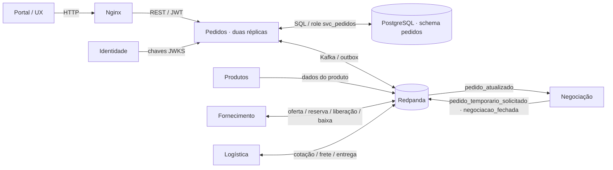

# ESP-PED-001 — Microsserviço de Pedidos do Portal B2B

Perfil de especificação: sistemas-distribuidos 1.0  
Serviço: `pedidos-service` · Área de trabalho: `portal-b2b-base/pedidos/`

| Versão | Data | Situação | Mudança |
|---|---|---|---|
| 1.1 | 2026-11-12 | Substituída | Pedido criado depois de `negociacao_fechada`, reserva por `pedido_criado` e conclusão por `PATCH`. |
| 2.0 | 2026-11-19 | Aprovado | Pedido temporário criado na abertura do leilão ou da negociação direta, conforme a regra do professor. Leilão conjunto com vários pedidos por negociação. Venda concluída no fechamento. Destino informado pelo comprador. Remove o `POST` de criação e o `PATCH` de conclusão. Decisões D-01 a D-08 da seção 13.1. |

[Arquitetura](#2-arquitetura) · [Stack](#3-stack-configuração-e-execução) · [Regras e estados](#5-regras-de-negócio-e-estados) · [API HTTP](#6-api-http-autenticação-e-erros) · [Eventos Kafka](#7-contratos-de-integração-por-eventos) · [Aceitação](#8-requisitos-funcionais-e-critérios-de-aceitação) · [Acordos entre grupos](#13-acordos-e-decisões-de-integração)

## 1. Objetivo e escopo

Registrar o pedido que bloqueia o estoque de uma oferta durante uma negociação e acompanhar esse pedido até a entrega. Quando a Negociação abre um leilão ou uma negociação direta, ela pede a Pedidos um **pedido temporário, sem comprador**, para cada oferta envolvida. O pedido reserva o estoque no Fornecimento. No fechamento, Pedidos efetiva os pedidos vendidos, define o comprador e o valor rateado, e conclui a venda. Os demais pedidos são cancelados e liberam a reserva. Depois da venda, o comprador informa o destino, a Logística cota e seleciona o frete, e a entrega encerra o pedido.

- **Dentro da v1:** criação do pedido temporário por Kafka; acompanhamento da reserva; efetivação ou cancelamento no fechamento; destino informado pelo comprador; registro do frete, da troca de transportadora e da entrega; consulta de pedidos e histórico; auditoria; publicação durável; operação no kit da turma.
- **Fora da v1 do Portal (nenhum serviço implementa):** emissão de nota fiscal e cancelamento manual pelo comprador ou fornecedor (confirmação com o professor em INT-PED-10), pagamento, comissão calculada e estorno de venda concluída.
- **Fora de Pedidos (responsável indicado):** matching (Mercado); condução do leilão, dos lances e do rateio (Negociação); manutenção do saldo, reserva, liberação e baixa (Fornecimento); escolha da transportadora e rastreio (Logística e Transportadoras). Vários itens no mesmo pedido não existem: cada pedido tem uma oferta de um produto.
- **Vocabulário:** *pedido temporário* é o pedido em `CRIADO`, sem comprador, que existe só para reservar a oferta durante a negociação. *Reserva* separa a quantidade da oferta para o pedido. *Baixa* retira definitivamente a quantidade reservada quando a venda é concluída. *Liberação* devolve ao disponível a quantidade reservada de um pedido cancelado. *Alocação* é a parte do lote vendida a uma oferta no fechamento, com o valor já rateado pela Negociação. *Outbox* é a tabela de eventos que Pedidos grava na mesma transação que a mudança de negócio.

### 1.1 Atores e fronteiras

| Ator ou grupo | Responsabilidade na integração com Pedidos |
|---|---|
| Comprador | Consulta os pedidos que comprou e informa o destino da entrega depois da venda. |
| Fornecedor | Consulta os pedidos das suas ofertas, inclusive os temporários. |
| Operador da plataforma | Consulta pedidos para suporte. Não cria nem altera pedidos na v1. |
| Negociação / Leilão | Pede um pedido temporário por oferta na abertura (`pedido_temporario_solicitado`), acompanha a reserva pelo `pedido_atualizado` e publica o fechamento com as alocações (`negociacao_fechada`). |
| Mercado | Sugere o leilão ao fornecedor. Não troca eventos com Pedidos. |
| Compra e Demanda | Não troca eventos com Pedidos. O destino da entrega não vem da demanda na v1. |
| Produtos | Fonte do nome, da unidade, do tipo de transporte e do peso unitário. Pedidos guarda uma projeção local desses dados. |
| Fornecimento | Fonte da origem e da identidade da oferta. Reserva ao receber `pedido_criado`, libera ao receber `CANCELADO` e dá baixa ao receber `VENDA_CONCLUIDA`. |
| Logística e Transportadoras | Logística cota quando o pedido entra em `AGUARDANDO_FRETE` e informa a seleção, a troca, a indisponibilidade e a entrega. |
| Identidade | Emite o JWT RS256, fornece as chaves JWKS e é a autoridade sobre usuários, empresas e escopos. |
| Infraestrutura | Mantém PostgreSQL, Redpanda, tópicos, gateway e observabilidade compartilhada. |
| Banco de Dados | Fornece o modelo DR-BD-002 e valida tipos e migrações. O schema `pedidos` pertence a Pedidos. |
| UX/UI | Mostra lista, detalhe e histórico e a tela em que o comprador informa o destino. |
| Teste e Qualidade | Valida os critérios, os envelopes, as evidências e o fluxo integrado. |

## 2. Arquitetura



Fluxo principal:

```text
1. Negociação ──pedido_temporario_solicitado──► Pedidos          cria o pedido CRIADO, sem comprador
2. Pedidos ──pedido_criado (compradorId null)──► Fornecimento     reserva a quantidade da oferta
3. Fornecimento ──estoque_atualizado RESERVA──► Pedidos           reservaSituacao CONFIRMADA
   (ou reserva_estoque_recusada ──► Pedidos                       CANCELADO)
4. Pedidos ──pedido_atualizado (reservaSituacao)──► Negociação    a oferta entra ou não no lote
5. Negociação ──negociacao_fechada (alocacoes)──► Pedidos
      pedido em alocacoes ─► VENDA_CONCLUIDA ──► Fornecimento dá baixa
      demais pedidos      ─► CANCELADO       ──► Fornecimento libera
6. Comprador ──PUT /destino──► Pedidos ─► AGUARDANDO_FRETE ──► Logística cota
7. Logística ──frete_selecionado──► FRETE_SELECIONADO ──entrega_concluida──► ENTREGUE
```

- **Domínio:** funções que recebem fatos já validados e decidem a transição. Armazenamento e publicação ficam nos adaptadores.
- **Aplicação:** os casos de uso HTTP e Kafka usam as mesmas transações. Cada instância atende HTTP e executa o consumidor e o publicador.
- **Persistência:** schema e role próprios no PostgreSQL do kit. Leituras, gravações e FKs ficam no schema `pedidos`. IDs de outros serviços são referências lógicas.
- **Consistência:** Pedidos garante a atomicidade no seu banco. Reserva, baixa, cotação e entrega são assíncronas, e cada serviço confirma sua etapa com um evento.
- **Instâncias:** as réplicas compartilham banco e grupo Kafka. Estado, chaves idempotentes e outbox sobrevivem à queda de qualquer instância.

## 3. Stack, configuração e execução

| Componente | Escolha para Pedidos |
|---|---|
| Linguagem e HTTP | Python 3.12, FastAPI, Pydantic 2 e Uvicorn. Porta interna `8107`, prefixo `/api/v1/pedidos`. |
| Banco | PostgreSQL 16, banco `portal_b2b`, schema `pedidos`, runtime `svc_pedidos`, migrações com `portal_ddl`. Psycopg 3 com pool de até 5 conexões por processo. Alembic e SQLAlchemy para migrações. |
| Kafka | Redpanda do kit, cliente `aiokafka`. A validação dos payloads de entrada usa modelos Pydantic que espelham a seção 7. Broker local na porta `19092`. No Compose do kit, `rp-0:9092,rp-1:9092,rp-2:9092`. |
| Autenticação | PyJWT com RS256 e cache de JWKS por até 1 h. |
| Execução e diagnóstico | Docker Compose v2, Nginx (`8080`), Kafka UI (`8090`), PgAdmin (`5050`), Prometheus e logs JSON. |
| Verificação | pytest, HTTPX, PostgreSQL e Redpanda reais, os payloads da seção 7 como contrato e k6 para carga. |

Bibliotecas de execução, lista fechada com versões fixadas no `requirements.txt`: `fastapi==0.162.5`, `starlette==1.10.0`, `uvicorn==0.54.0`, `pydantic==2.14.3`, `psycopg[binary]==3.3.9`, `psycopg-pool==3.3.3`, `alembic==1.20.1`, `SQLAlchemy==2.1.8`, `aiokafka==0.15.0`, `PyJWT[crypto]==2.15.1`, `cryptography==50.0.2`, `simplejson==3.20.2` e `prometheus-client==0.26.0`. Bibliotecas de teste em `requirements-test.txt`: `httpx==0.28.1` e `pytest==9.2.0`. Imagens da demonstração: `postgres:16-alpine`, `docker.redpanda.com/redpandadata/redpanda:v24.1.8` e `nginx:1.27-alpine`. O `migracoes/env.py` força o driver `postgresql+psycopg` sobre a `MIGRATION_DATABASE_URL`, que pode ser informada como `postgresql://`.

| Configuração | Regra |
|---|---|
| `DATABASE_URL` / `MIGRATION_DATABASE_URL` | DSNs separadas, com as roles de runtime e migração. Só o processo de migração recebe a segunda. |
| `KAFKA_BOOTSTRAP_SERVERS` / `KAFKA_GROUP_ID` | Lista do ambiente e grupo estável `pedidos-service-v1` na integração. Testes isolados usam outro grupo. |
| `JWKS_URL` / `JWT_ISSUER` / `JWT_AUDIENCE` | Fornecidos por Identidade e Infra. Valores de trabalho: `identity-service` e `b2b-platform` (INT-PED-08). |
| `LOG_LEVEL` | `INFO` por padrão. O contêiner escuta na porta `8107`. |

Valores da demonstração isolada (`compose.demo.yml`), que também são o conteúdo do `.env.example`:

```text
DATABASE_URL=postgresql://svc_pedidos:pedidos_demo_app@db:5432/portal_b2b
MIGRATION_DATABASE_URL=postgresql://portal_ddl:pedidos_demo_ddl@db:5432/portal_b2b
KAFKA_BOOTSTRAP_SERVERS=broker:9092
KAFKA_GROUP_ID=pedidos-fluxo-demo
JWKS_URL=http://identity:8000/.well-known/jwks.json
JWT_ISSUER=identity-service
JWT_AUDIENCE=b2b-platform
LOG_LEVEL=INFO
```

Estrutura, relativa à pasta `pedidos/`:

```text
pedidos/
├── docs/                 # publicado em docs/pedidos/ no repositório do grupo
│   ├── README.md         # visão geral, fronteiras e pendências
│   ├── requisitos.md     # esta especificação
│   └── contratos/        # <topico>.schema.json e <topico>[.variante].exemplo.json
├── app/
│   ├── main.py
│   ├── dominio.py
│   ├── http.py
│   ├── contratos.py
│   ├── jsonio.py
│   └── adaptadores/
│       ├── postgres.py
│       ├── kafka.py
│       └── jwks.py
├── migracoes/
├── demo/                 # init.sql (roles e schema) e nginx.conf da demonstração
├── tests/                # testes e emissor de tokens de teste
├── validacao/            # relatório, resultado JUnit e scripts de verificação operacional
├── alembic.ini
├── requirements.txt
├── requirements-test.txt
├── .env.example
├── Dockerfile
├── compose.demo.yml
└── compose.pedidos.yml
```

Em `pedidos/`, com as variáveis exportadas e as dependências instaladas:

```powershell
python -m pip install -r requirements.txt
python -m alembic upgrade head
python -m uvicorn app.main:app --host 0.0.0.0 --port 8107
```

A demonstração isolada usa o `compose.demo.yml`: PostgreSQL 16 (`db`), Redpanda (`broker`, sem criação automática de tópicos), a tarefa `topicos`, que cria com 3 partições todos os tópicos da seção 7.1, a tarefa `migrar`, o emissor de tokens de teste `identity` (`tests/demo_identity.py`, que publica a JWKS), as réplicas `app1` e `app2`, o `gateway` Nginx na porta `18107` do host e o executor de testes `teste`. Na pasta `pedidos/`:

```powershell
docker compose -f compose.demo.yml up -d --build gateway
docker compose -f compose.demo.yml run --build --rm --no-deps teste python -m pytest -q --junitxml=validacao/resultado-pedidos.xml
```

O primeiro comando sobe a stack e termina quando o `gateway` está de pé. O gateway da demonstração encaminha todos os caminhos às réplicas, então a aplicação está pronta quando `GET http://localhost:18107/health/ready` responde `200`. O segundo comando é o comando oficial dos testes e grava o JUnit em `validacao/resultado-pedidos.xml`. Para zerar os dados entre execuções, use `docker compose -f compose.demo.yml down -v`. Cada CA gera IDs novos (seção 11, item 2), então não é preciso zerar entre CAs. Os CAs que param serviços (CA-PED-06.2, CA-PED-06.3 e RNF-PED-06) são executados do host pelo script `validacao/validar-operacao.ps1` (PowerShell 7). No CA-PED-06.2, o script para `app1` e `app2` e roda `docker compose -f compose.demo.yml run --rm --no-deps teste python -m pytest -q -k ca_ped_06_2`, em que o teste executa a aplicação no próprio processo. O `Dockerfile` usa a imagem base `python:3.12-slim`, que também serve ao emissor `identity`. A carga usa a imagem `grafana/k6:0.54.0`.

A integração no kit usa o `compose.pedidos.yml` como override das entradas `app1-pedidos` e `app2-pedidos` na rede `portal-net`, com a tarefa `pedidos-migrate` para as migrações. O override só define o build a partir de `${PEDIDOS_PROJECT_DIR}` e repassa as variáveis da tabela acima. Os valores de host, credenciais, JWKS e rota no gateway são os do kit, fornecidos por Infra (INT-PED-07). [Compose do kit](https://github.com/Printf-PedroCardoso/portal-b2b-kit-infra/blob/630515c4891705fb9563897ec8e2590a9ef7968e/docker-compose.yml)

## 4. Modelo de dados e propriedade

Os IDs gerados por Pedidos são UUID, gravados e publicados em minúsculas. Onde um ID gerado por Pedidos é recebido (`pedidoId` em eventos, alocações e na URL), aceitar qualquer caixa e comparar o UUID normalizado em minúsculas. Os IDs externos são textos não vazios de até 64 caracteres, com UUID como formato preferencial, preservados sem conversão e comparados como texto exato. `comprador_id` e `fornecedor_id` são comparados com o `tenant_id` emitido por Identidade.

| Campo ou grupo em `pedidos.pedido` | Tipo e restrição |
|---|---|
| `id` | UUID gerado na criação. |
| `negociacao_id`, `fornecimento_id` | Referências externas obrigatórias. **`UNIQUE(negociacao_id, fornecimento_id)`**: um pedido por oferta em cada negociação. |
| `tipo_negociacao` | `LEILAO` ou `VENDA_DIRETA`, copiado da solicitação. |
| `produto_id`, `fornecedor_id` | Referências externas obrigatórias. A solicitação e a projeção da oferta devem concordar. |
| `comprador_id` | Referência externa. **Nula** enquanto o pedido é temporário. Preenchida na efetivação. |
| `quantidade`, `unidade` | `NUMERIC(12,2)` maior que zero e enum `KG`, `TON`, `UN`, `CX`, `L`. |
| `preco_unitario_oferta` | `NUMERIC(18,4)` positivo, preço da oferta na solicitação, com até 2 casas na entrada. |
| `valor_unitario`, `valor_total` | `NUMERIC(18,4)` em BRL. No pedido temporário, `valor_unitario` = `preco_unitario_oferta` e `valor_total` = quantidade × preço da oferta, arredondado para 2 casas com `ROUND_HALF_UP`. Na efetivação, os dois recebem os valores da alocação, sem recálculo. |
| `produto_nome`, `tipo_transporte`, `peso_kg` | Nome de 1 a 255 caracteres, tipo `GRANEL`, `REFRIGERADO`, `CARGA_SECA` ou `PERIGOSO` e peso positivo `NUMERIC(24,5)`. Snapshot imutável tomado na criação. |
| `origem` | `{cidade, uf}` obrigatório, da projeção da oferta. Cidade de 1 a 120 caracteres e uma das 27 siglas brasileiras em maiúsculas. |
| `destino`, `data_entrega_desejada` | `destino` é nulo até o comprador informar e segue as mesmas regras de `origem`. Os espaços das pontas da cidade são removidos antes de validar e gravar. Data opcional `YYYY-MM-DD`, maior ou igual à data atual em `America/Sao_Paulo`. |
| `status`, `reserva_situacao`, `motivo_cancelamento`, `versao` | Status da seção 5.1. Reserva `PENDENTE`, `CONFIRMADA`, `RECUSADA` ou `ENCERRADA`. Motivo nulo ou um de `ESTOQUE_INSUFICIENTE`, `FORNECIMENTO_INEXISTENTE`, `FORA_DO_LOTE` e `NEGOCIACAO_SEM_VENDA`. Inteiro monotônico iniciado em 1. |
| `ocorrencia_frete` | `JSONB` nulo ou `{"motivo": ..., "ocorridoEm": ...}` do último `frete_indisponivel` aplicado. Exposto como `ocorrenciaFrete`. Não muda a versão, mas atualiza `atualizado_em`. |
| `criado_em`, `atualizado_em`, `vendido_em`, `entregue_em` | `TIMESTAMPTZ` em UTC. Os dois primeiros são obrigatórios. `vendido_em` é o instante em que Pedidos aplicou o fechamento. `entregue_em` é o `entregueEm` recebido da Logística. |

| Registro local | Campos essenciais e finalidade |
|---|---|
| `solicitacao_pendente` | Solicitação recebida sem projeção de produto ou de oferta. Chave `(negociacao_id, fornecimento_id)`, `event_id`, `correlation_id`, dados, causa e `recebido_em`. |
| `negociacao_encerrada` | `negociacao_id`, status final, `event_id`, hash das alocações e `recebido_em`. Impede criar pedido temporário para negociação já fechada e detecta fechamento divergente. |
| `produto_referencia`, `fornecimento_referencia` | IDs externos como chave, campos projetados da seção 7.2, `event_id` e `timestamp` do último estado aplicado. |
| `solicitacao_frete` | Pedido e `solicitacao_frete_id`, com a situação `VIGENTE` ou `SUBSTITUIDA`. Só uma vigente por pedido. |
| `pedido_frete` | Pedido, `solicitacao_frete_id`, `entrega_id`, `cotacao_id`, `transportadora_id`, `tentativa`, `preco`, `prazo_dias`, previsão opcional e situação aplicada ou substituída. Chave `(pedido_id, solicitacao_frete_id, tentativa)`. |
| `fato_logistico_pendente` | Entrega recebida antes da seleção correspondente. Pedido, `entrega_id`, transportadora, mensagem e horário. |
| `pedido_historico` | `(pedido_id, versao)` único. Estado e reserva anteriores e novos, `origem`, motivo, `event_id` ou ator HTTP, `correlation_id` e instante. `origem` é o nome do tópico que causou a mudança (`pedido_temporario_solicitado`, `estoque_atualizado`, `reserva_estoque_recusada`, `negociacao_fechada`, `frete_selecionado`, `entrega_concluida`) ou `http_destino`. Na criação feita pelo reconciliador, a origem continua `pedido_temporario_solicitado`. O `ENTREGUE` aplicado a partir de `fato_logistico_pendente` tem origem `entrega_concluida` e o `event_id` da entrega. |
| `audit_log` | `acao`, pedido ou negociação, usuário, tenant, evento, correlação, instante e detalhe. `acao`, `instante` e `detalhe` (JSONB com, no mínimo, o tópico e o ID de negócio) são obrigatórios. Pedido, negociação, usuário, tenant e evento podem ser nulos. Conflitos de projeção, como o empate de `timestamp` de produto e a `fornecimento_criado` repetida com dados diferentes, são gravados com `acao=EVENTO_CONFLITANTE`, sem pedido nem negociação. Lista fechada de `acao`: `PEDIDO_CRIADO`, `RESERVA_CONFIRMADA`, `PEDIDO_CANCELADO`, `VENDA_CONCLUIDA`, `DESTINO_INFORMADO`, `FRETE_APLICADO`, `ENTREGA_APLICADA`, `SOLICITACAO_DESCARTADA`, `SOLICITACAO_INVALIDA`, `ESTOQUE_REGISTRADO`, `EVENTO_CONFLITANTE`, `EVENTO_FORA_DE_ESTADO`, `EVENTO_NAO_CORRELACIONADO`, `ENTREGA_DESCARTADA` e `FRETE_INDISPONIVEL`. |
| `idempotency_keys` | Usuário, contexto, método, caminho e `Idempotency-Key`. Hash do corpo e resposta original, válida por 24 h. |
| `processed_events` | `(source, event_id)` único, hash da mensagem, tópico, partição, offset, resultado e instante. Janela mínima de 30 dias. |
| `outbox` | `event_id` UUID único, pedido, versão, tópico, chave, envelope, tentativas, próximo envio, confirmação e erro resumido. `(pedido_id, versao)` único. |

O peso é igual à quantidade para `KG`, à quantidade × 1000 para `TON` e à quantidade × `pesoUnitarioKg` para `UN`, `CX` e `L`. Sem `pesoUnitarioKg` nessas unidades, a solicitação fica pendente de dados.

**Números no JSON.** Quantidades, valores e pesos usam `Decimal` na aplicação e saem como **números JSON**, nunca como string. Valores em BRL saem com 2 casas, quantidades com até 2 casas e `pesoKg` com até 3 casas, sem zeros à direita obrigatórios. Os testes comparam esses campos por valor numérico: `650`, `650.0` e `650.00` são iguais. Todo arredondamento calculado por Pedidos (valor temporário e peso) usa `ROUND_HALF_UP` para o número de casas de saída. Limites de magnitude: quantidades até `9999999999.99` e valores em BRL (de entrada ou calculados) até `99999999999999.99`. Entrada ou resultado acima do limite torna a mensagem inválida (DLT `EVENTO_INVALIDO`). Valores recebidos com mais casas que o contrato permite não são arredondados: a mensagem é inválida.

**Datas e horas.** Saída sempre em UTC no formato `YYYY-MM-DDTHH:MM:SS.mmmZ`. Na entrada, aceitar ISO 8601 com `Z` ou com offset explícito (`+00:00`, `-03:00`) e converter para UTC. Data e hora sem offset são inválidas. Datas sem hora usam `YYYY-MM-DD`.

**Fixture.** Três ofertas do mesmo produto (`35000000-0000-4000-8000-000000000001`, Milho em grão, `TON`, `GRANEL`) e uma negociação `N` = `31000000-0000-4000-8000-000000000001`:

| Oferta | `fornecimentoId` | `fornecedorId` | Origem | Quantidade na solicitação | `precoUnitario` | Peso | Valor temporário |
|---|---|---|---|---:|---:|---:|---:|
| `F1` | `34000000-0000-4000-8000-000000000001` | `a1000000-0000-4000-8000-000000000001` | Rio Verde/GO | 5.00 | 120.00 | 5000 | 600.00 |
| `F2` | `34000000-0000-4000-8000-000000000002` | `a1000000-0000-4000-8000-000000000002` | Jataí/GO | 15.00 | 125.00 | 15000 | 1875.00 |
| `F3` | `34000000-0000-4000-8000-000000000003` | `a1000000-0000-4000-8000-000000000003` | Mineiros/GO | 10.00 | 118.00 | 10000 | 1180.00 |

O comprador da fixture é `b2000000-0000-4000-8000-000000000002`. A empresa "outra" dos testes de visibilidade é `c3000000-0000-4000-8000-000000000003`.

## 5. Regras de negócio e estados

| ID | Regra | Requisitos |
|---|---|---|
| RN-PED-01 | Cada `pedido_temporario_solicitado` cria no máximo um pedido por `(negociacaoId, fornecimentoId)`. O banco impõe a unicidade, inclusive entre réplicas. Uma solicitação com outro `eventId` para um `(negociacaoId, fornecimentoId)` que já tem pedido é duplicata se `tipo`, `fornecedorId`, `produtoId`, `quantidade` e `precoUnitario` forem iguais. Se algum for diferente, gera auditoria `EVENTO_CONFLITANTE`, sem mudança. Uma solicitação para negociação já encerrada localmente não cria pedido e gera auditoria `SOLICITACAO_DESCARTADA`. Criação e fechamento da mesma negociação se serializam pelo mesmo bloqueio (seção 9). Ordem de avaliação de uma solicitação válida: (1) já existe pedido ou solicitação pendente para a chave → duplicata ou `EVENTO_CONFLITANTE`, conforme os dados; (2) negociação encerrada → `SOLICITACAO_DESCARTADA`; (3) alguma projeção presente que já diverge da solicitação (mesmo com a outra ausente) → DLT `CONTRATO_DIVERGENTE`; (4) projeção ausente → pendente; (5) senão, cria o pedido. | PED-01 |
| RN-PED-02 | O pedido temporário é criado em `CRIADO`, sem comprador, com reserva `PENDENTE`, e publica `pedido_criado` com `compradorId: null`. Sem projeção de produto ou de oferta, a solicitação fica pendente e é reavaliada quando o dado chegar, pelo mesmo caso de uso. Se a reavaliação encontrar fornecedor, produto ou unidade divergentes da projeção, a solicitação é descartada com auditoria `SOLICITACAO_INVALIDA`, sem pedido. | PED-01 |
| RN-PED-03 | `estoque_atualizado` com `operacao: "RESERVA"`, o `pedidoId`, o `fornecimentoId` e `quantidadeMovimentada` igual à quantidade do pedido confirma a reserva `PENDENTE`: `reservaSituacao` vai a `CONFIRMADA` e o status continua `CRIADO`. `reserva_estoque_recusada` com o `pedidoId`, o `fornecimentoId` e `quantidadeSolicitada` iguais aos do pedido, com reserva `PENDENTE`, cancela com o `motivo` recebido (`ESTOQUE_INSUFICIENTE` ou `FORNECIMENTO_INEXISTENTE`) e reserva `RECUSADA`. As duas mudanças publicam `pedido_atualizado`. Uma `RESERVA` correspondente com a reserva já `CONFIRMADA` não tem efeito nem auditoria. `RESERVA` ou recusa com oferta ou quantidade diferente, e recusa para reserva já `CONFIRMADA`, geram auditoria `EVENTO_CONFLITANTE`, sem mudança. | PED-03 |
| RN-PED-04 | `estoque_atualizado` com `REPOSICAO` ou `ENCERRAMENTO` (sem `pedidoId`) não muda nada e não gera auditoria. `LIBERACAO` e `BAIXA` de pedido conhecido, em qualquer status, inclusive terminal, geram auditoria `ESTOQUE_REGISTRADO`, sem versão nova. | PED-03 |
| RN-PED-05 | A validação de envelope e payload da seção 7.1 vem sempre primeiro. Depois dela, se a negociação já tem fechamento aplicado em `negociacao_encerrada`, vale o último parágrafo da seção 5.1, antes das validações contra os pedidos locais desta regra. Senão, Pedidos valida o fechamento inteiro contra os pedidos locais da negociação. Com `status: "ENCERRADO"`, cada alocação precisa apontar para um pedido existente da mesma negociação, em `CRIADO`, com reserva `CONFIRMADA`, mesmo `fornecimentoId`, mesmo `fornecedorId`, mesma `quantidade`, e o `produtoId` e o `tipo` do fechamento iguais aos do pedido, e nenhum `pedidoId` ou `fornecimentoId` pode se repetir entre alocações. Se qualquer alocação falhar, **nenhum pedido muda**: a mensagem vai para `pedidos.dlt` com `error="FECHAMENTO_INCOMPATIVEL"` e a negociação não é marcada como encerrada, de modo que um fechamento corrigido, com outro `eventId`, ainda pode ser aplicado. Com o fechamento válido, cada pedido de `alocacoes` recebe `compradorId`, `valorUnitario` e `valorTotal` da alocação e vai a `VENDA_CONCLUIDA`. Todo fechamento aplicado, inclusive `DESERTO`, `RECUSADO` ou `EXPIRADO` de negociação sem pedidos locais, grava `negociacao_encerrada`. | PED-04 |
| RN-PED-06 | No fechamento, todo pedido não terminal da negociação que não esteja em `alocacoes` é cancelado. O motivo é `FORA_DO_LOTE` quando o status é `ENCERRADO` e `NEGOCIACAO_SEM_VENDA` quando é `DESERTO`, `RECUSADO` ou `EXPIRADO`. A reserva vai a `ENCERRADA` se estava confirmada ou pendente. | PED-04 |
| RN-PED-07 | Só o comprador do pedido, com escopo `BUYER`, informa o destino, e só em `VENDA_CONCLUIDA`. O pedido vai a `AGUARDANDO_FRETE` e publica `pedido_atualizado` com o snapshot de carga completo, que é o sinal para a Logística cotar. Com o pedido em `AGUARDANDO_FRETE`, `FRETE_SELECIONADO` ou `ENTREGUE`, um `PUT` com a mesma cidade (após remover os espaços das pontas, comparação exata), a mesma `uf` e a mesma `dataEntregaDesejada` (ausente e `null` são iguais) devolve `200` com o detalhe atual, sem versão nova. Qualquer diferença devolve `409 TRANSICAO_INVALIDA`. A validação de formato da seção 4 vale só para destino novo: a repetição de um destino já gravado com data que entrou no passado devolve `200`. | PED-05 |
| RN-PED-08 | **Eventos de frete** são `solicitacao_frete_criada`, `frete_selecionado`, `entrega_concluida` e `frete_indisponivel`. Eles só valem com o pedido em `AGUARDANDO_FRETE` ou `FRETE_SELECIONADO`. Em `CRIADO` ou `VENDA_CONCLUIDA`, geram auditoria `EVENTO_FORA_DE_ESTADO`, sem efeito e sem guardar fato pendente. **Solicitação vigente:** um `solicitacao_frete_criada` ou um `frete_selecionado` com `solicitacaoFreteId` desconhecido torna essa solicitação vigente só se o pedido ainda não tem solicitação vigente ou se a vigente já recebeu `frete_indisponivel`. Nesse caso, a anterior passa a `SUBSTITUIDA`. Se o pedido já tem outra solicitação vigente sem `frete_indisponivel`, o evento gera `EVENTO_CONFLITANTE`, sem efeito. Uma solicitação `SUBSTITUIDA` nunca volta a vigente. Trocar a solicitação vigente não cria versão nem evento. Com o pedido em `FRETE_SELECIONADO`, o `frete` continua com a seleção anterior até chegar um `frete_selecionado` da nova solicitação, e a entrega da seleção anterior passa a ser de solicitação substituída (RN-PED-09). `frete_selecionado` da solicitação vigente leva a `FRETE_SELECIONADO`. Na mesma solicitação, tentativa maior substitui a anterior e gera nova versão, mantendo o status. Tentativa menor é ignorada. Mesma tentativa com dados iguais é repetição. Mesma tentativa com dados diferentes gera `EVENTO_CONFLITANTE`. Evento de solicitação substituída é ignorado com `EVENTO_FORA_DE_ESTADO`. | PED-05 |
| RN-PED-09 | `entrega_concluida` cuja entrega e transportadora correspondam à seleção vigente leva a `ENTREGUE` com o `entregueEm` recebido. Entrega de seleção ainda desconhecida fica guardada em `fato_logistico_pendente` e é aplicada quando a seleção correspondente chegar. Entrega de tentativa ou solicitação substituída é descartada com auditoria `ENTREGA_DESCARTADA`. Entrega cujo `entregaId` é o da seleção vigente com outra `transportadoraId`, ou cuja `transportadoraId` é a da seleção vigente com outro `entregaId`, gera `EVENTO_CONFLITANTE` e é descartada. | PED-05 |
| RN-PED-10 | `frete_indisponivel` de solicitação substituída gera `EVENTO_FORA_DE_ESTADO`, e de solicitação desconhecida gera `EVENTO_NAO_CORRELACIONADO`, ambos sem efeito. `frete_indisponivel` da solicitação vigente não cancela o pedido, porque a baixa já ocorreu. O pedido continua no status atual, sem versão nova e sem `pedido_atualizado`. A ocorrência fica em `ocorrencia_frete` e na auditoria `FRETE_INDISPONIVEL`. A Logística reabre a cotação com uma nova `solicitacao_frete_criada` para o mesmo pedido (INT-PED-05). | PED-05 |
| RN-PED-11 | Pedido, histórico, auditoria, deduplicação e evento de saída de uma mesma mudança são gravados na mesma transação. A outbox reutiliza o `eventId` em todo reenvio. Os eventos de saída sempre levam `pedidoId`, `negociacaoId` e `fornecimentoId`. | PED-06 |
| RN-PED-12 | Consultas aplicam a visibilidade antes da paginação. O fornecedor vê os pedidos das suas ofertas desde a criação. O comprador vê o pedido só depois de definido como comprador. Pedido fora da visibilidade responde `404`. | PED-02 |

### 5.1 Estados e transições

```text
CRIADO ──(reserva confirmada: só reservaSituacao muda)──► CRIADO
CRIADO ──(fechamento com alocação)──► VENDA_CONCLUIDA ──(destino)──► AGUARDANDO_FRETE
       ──(frete_selecionado)──► FRETE_SELECIONADO ──(entrega_concluida)──► ENTREGUE
CRIADO ──(reserva recusada | fora do lote | sem venda)──► CANCELADO
```

| Estado anterior | Gatilho e precondição | Resultado |
|---|---|---|
| Sem pedido | `pedido_temporario_solicitado` com projeções disponíveis e negociação aberta | `CRIADO`, reserva `PENDENTE`, versão 1, `pedido_criado`. |
| `CRIADO`, reserva `PENDENTE` | `estoque_atualizado` `RESERVA` correspondente | Reserva `CONFIRMADA`, nova versão, `pedido_atualizado` com `status: "CRIADO"`. |
| `CRIADO`, reserva `PENDENTE` | `reserva_estoque_recusada` do pedido | `CANCELADO`, reserva `RECUSADA`, motivo da recusa. |
| `CRIADO`, reserva `CONFIRMADA` | `negociacao_fechada` `ENCERRADO` com alocação correspondente | `VENDA_CONCLUIDA` com comprador e valores da alocação. |
| `CRIADO` | `negociacao_fechada` sem o pedido em `alocacoes` | `CANCELADO`, reserva `ENCERRADA`, motivo `FORA_DO_LOTE` ou `NEGOCIACAO_SEM_VENDA`. |
| `VENDA_CONCLUIDA` | `PUT /destino` do comprador | `AGUARDANDO_FRETE` com destino. |
| `AGUARDANDO_FRETE` | `frete_selecionado` válido | `FRETE_SELECIONADO`. |
| `FRETE_SELECIONADO` | `frete_selecionado` com tentativa maior da mesma solicitação, ou qualquer tentativa de uma nova solicitação que se tornou vigente (RN-PED-08) | Mesmo status, nova versão com o frete substituído e `pedido_atualizado`. |
| `FRETE_SELECIONADO` | `entrega_concluida` da seleção vigente | `ENTREGUE`. |
| `AGUARDANDO_FRETE` ou `FRETE_SELECIONADO` | `frete_indisponivel` da solicitação vigente | Mesmo status, sem versão nova. `ocorrenciaFrete` preenchido. |
| `CANCELADO` ou `ENTREGUE` | Qualquer evento de negócio tardio | Estado terminal, sem mudança. A repetição de um fato já aplicado ao pedido (mesmo tópico e mesmos dados de negócio, com qualquer `eventId`) fica sem efeito e sem auditoria. `LIBERACAO` e `BAIXA` seguem RN-PED-04. Os demais eventos geram `EVENTO_FORA_DE_ESTADO`. |

Uma confirmação de reserva tardia para pedido já cancelado não muda o pedido: Fornecimento já registrou o cancelamento e libera. Depois que um fechamento válido foi aplicado, um segundo fechamento da mesma negociação com o mesmo conteúdo é duplicata, e com conteúdo diferente gera `EVENTO_CONFLITANTE`, sem desfazer o primeiro. O conteúdo comparado é `status`, `compradorId` e a lista `alocacoes` ordenada por `pedidoId`, com números comparados por valor.

## 6. API HTTP, autenticação e erros

### 6.1 Acesso

O gateway propaga `X-Correlation-Id`. Pedidos aceita de 1 a 128 caracteres de `[A-Za-z0-9._-]`. Se ausente ou inválido, gera um UUID e devolve o valor efetivo no cabeçalho e nos erros.

A API de negócio valida JWT Bearer RS256: `kid`, assinatura, `iss`, `aud`, `exp` e `nbf` quando presente, com tolerância de relógio de 0 s. Usa `sub` como usuário, `tenant_id` como empresa e `active_scope` como escopo. `BUYER` vê os pedidos em que a empresa é compradora. `SUPPLIER` vê os pedidos em que a empresa é fornecedora. `TENANT_ADMIN` vê os dois lados da mesma empresa. Um token com `platform_role=PLATFORM_ADMIN` dispensa `tenant_id` e `active_scope`, consulta qualquer pedido e recebe `403 ACESSO_NEGADO` no `PUT /destino`. `CARRIER` não acessa a API de Pedidos. Um token sem `tenant_id` ou sem `active_scope`, e sem `PLATFORM_ADMIN`, recebe `403 CONTEXTO_NAO_SELECIONADO`. Chave em cache vale enquanto estiver no prazo. No cache miss, consulta a JWKS com timeout de 2 s. Resposta sem a chave → `401`. JWKS indisponível sem chave em cache → `503`.

### 6.2 Rotas

Rotas de negócio retornam JSON. IDs de pedido na URL são UUID. Listagem e histórico aceitam `page` a partir de 1 e `size` de 1 a 100, com padrão `page=1&size=10`. A listagem aceita os filtros opcionais `status` (um único valor do enum da seção 5.1) e `negociacaoId` (um único ID). A ordenação é `criadoEm DESC, pedidoId DESC` na lista e `versao ASC` no histórico. Parâmetro de consulta repetido ou desconhecido devolve `422`. No histórico, a versão 1 tem `statusAnterior: null`.

| Método e rota | Entrada | Saída de sucesso |
|---|---|---|
| `GET /api/v1/pedidos` | Filtros e paginação. | `200` com `{items, page, size, total}`. Cada resumo tem `pedidoId`, `negociacaoId`, `fornecimentoId`, `compradorId`, `fornecedorId`, `status`, `valorTotal` e `criadoEm`. |
| `GET /api/v1/pedidos/{id}` | ID na URL. | `200` com o detalhe. |
| `GET /api/v1/pedidos/{id}/historico` | ID e paginação. | `200` com `{items, page, size, total}`. Cada item tem `versao`, `statusAnterior`, `status`, `reservaSituacao`, `origem`, `motivo` e `ocorridoEm`. |
| `PUT /api/v1/pedidos/{id}/destino` | `{"cidade":"Anápolis","uf":"GO","dataEntregaDesejada":"2026-11-25"}`. `cidade` e `uf` obrigatórios, data opcional. Campo fora desse objeto → `422`. `Idempotency-Key` opcional. | `200` com o detalhe em `AGUARDANDO_FRETE`. Repetição: RN-PED-07. |
| `GET /health` | Sem token. | `200` com `{"status":"up"}` enquanto o processo estiver vivo. |
| `GET /health/ready` | Sem token. | `200` com `{"status":"ready"}` com o schema migrado e banco e Kafka acessíveis. Senão `503` com `{"status":"not_ready"}`. |
| `GET /metrics`, `GET /docs` | Sem token. | Exposição Prometheus e Swagger UI. |

`/health`, `/health/ready`, `/metrics` e `/docs` atendem na porta interna `8107`. Na demonstração, o gateway também as encaminha. No kit, o gateway roteia só `/api/v1/pedidos`. `/health/ready` considera o Kafka acessível quando uma consulta de metadados ao broker, com timeout de 2 s, encontra os tópicos da seção 7.1. As rotas de negócio dependem só do banco: com o Kafka fora e o banco disponível, elas respondem normalmente, e a outbox guarda os eventos até o Kafka voltar. Nesse período, `/health/ready` responde `503`.

Exemplo de detalhe de um pedido efetivado, antes do destino. `frete` é nulo até a seleção aplicada. `ocorrenciaFrete` é nulo ou `{motivo, ocorridoEm}` do último `frete_indisponivel`.

```json
{
  "pedidoId":"32000000-0000-4000-8000-000000000001",
  "negociacaoId":"31000000-0000-4000-8000-000000000001",
  "tipoNegociacao":"LEILAO",
  "compradorId":"b2000000-0000-4000-8000-000000000002",
  "fornecedorId":"a1000000-0000-4000-8000-000000000001",
  "fornecimentoId":"34000000-0000-4000-8000-000000000001",
  "produtoId":"35000000-0000-4000-8000-000000000001",
  "produtoNome":"Milho em grão",
  "quantidade":5.00,
  "unidade":"TON",
  "valorUnitario":130.00,
  "valorTotal":650.00,
  "pesoKg":5000,
  "tipoTransporte":"GRANEL",
  "origem":{"cidade":"Rio Verde","uf":"GO"},
  "destino":null,
  "dataEntregaDesejada":null,
  "status":"VENDA_CONCLUIDA",
  "reservaSituacao":"CONFIRMADA",
  "motivoCancelamento":null,
  "frete":null,
  "ocorrenciaFrete":null,
  "versao":3,
  "criadoEm":"2026-11-20T12:00:01.000Z",
  "atualizadoEm":"2026-11-20T15:00:01.000Z",
  "vendidoEm":"2026-11-20T15:00:01.000Z",
  "entregueEm":null
}
```

Quando preenchido, `frete` contém `solicitacaoFreteId`, `entregaId`, `cotacaoId`, `transportadoraId`, `tentativa`, `preco`, `prazoDias` e `dataEntregaPrevista` (nula se ausente).

Exemplo de item de histórico:

```json
{"versao":2,"statusAnterior":"CRIADO","status":"CRIADO","reservaSituacao":"CONFIRMADA","origem":"estoque_atualizado","motivo":null,"ocorridoEm":"2026-11-20T12:00:05.000Z"}
```

`Idempotency-Key`, quando enviada, tem de 1 a 128 caracteres de `[A-Za-z0-9._-]`. Fora desse formato, a requisição recebe `422 VALIDACAO_INVALIDA` no passo "validar a entrada". O escopo é `sub` + `tenant_id` + `active_scope` + método + caminho. Para a mesma chave, escopo e corpo, a resposta original prevalece por 24 h. Mesma chave com corpo diferente → `409 IDEMPOTENCIA_CONFLITO`. Duas requisições simultâneas com a mesma chave são serializadas: a segunda espera a primeira terminar e recebe a resposta original. Só respostas de sucesso consomem a chave.

### 6.3 Erros

`Content-Type: application/problem+json`. `type` é `"about:blank"`, `instance` é o caminho sem query string, `correlationId` é o cabeçalho efetivo e `timestamp` é UTC ISO 8601 com milissegundos.

| Situação | `status` | `title` | `codigo` | `detail` |
|---|---:|---|---|---|
| Token ausente ou inválido | 401 | Não autenticado | TOKEN_INVALIDO | Token de acesso ausente ou inválido. |
| Token sem empresa ou escopo | 403 | Acesso negado | CONTEXTO_NAO_SELECIONADO | Selecione um contexto de empresa válido. |
| Escopo sem acesso à operação | 403 | Acesso negado | ACESSO_NEGADO | Você não tem permissão para esta operação. |
| Pedido ausente ou fora da visibilidade | 404 | Não encontrado | PEDIDO_NAO_ENCONTRADO | Pedido não encontrado. |
| Estado atual impede a operação | 409 | Conflito | TRANSICAO_INVALIDA | O estado atual do pedido não permite essa transição. |
| Reuso de chave com corpo diferente | 409 | Conflito | IDEMPOTENCIA_CONFLITO | A chave de idempotência já foi usada com outro corpo. |
| Entrada, UUID, enum, data ou paginação inválidos | 422 | Entrada inválida | VALIDACAO_INVALIDA | Os dados da requisição são inválidos. |
| Banco ou JWKS necessária indisponível | 503 | Serviço indisponível | DEPENDENCIA_INDISPONIVEL | Uma dependência necessária está indisponível. |
| Falha inesperada | 500 | Erro interno | ERRO_INTERNO | Não foi possível processar a requisição. |

```json
{
  "type":"about:blank",
  "title":"Conflito",
  "status":409,
  "codigo":"TRANSICAO_INVALIDA",
  "detail":"O estado atual do pedido não permite essa transição.",
  "instance":"/api/v1/pedidos/32000000-0000-4000-8000-000000000001/destino",
  "correlationId":"teste-ped-01",
  "timestamp":"2026-11-20T12:00:00.000Z"
}
```

Ordem da API: correlacionar, autenticar, autorizar o escopo, validar a entrada, verificar a visibilidade, aplicar a idempotência e avaliar o domínio. No `PUT /destino`, um comprador que não é o comprador do pedido recebe `404`. O passo "validar a entrada" confere o formato do corpo (campos, tipos, `uf`, cidade e formato da data). A regra "data maior ou igual a hoje" é avaliada no domínio, depois da visibilidade e da verificação de repetição da RN-PED-07, e devolve `422 VALIDACAO_INVALIDA` quando falha. Uma rejeição não altera pedido, versão, histórico nem outbox. O `401` envia `WWW-Authenticate: Bearer`. Corpo que não é JSON válido recebe `422 VALIDACAO_INVALIDA`. Rota fora da seção 6.2 e método não suportado numa rota existente recebem a resposta padrão do FastAPI (`404` e `405` com `{"detail": ...}`), fora do formato problem+json. O formato com `codigo` e `correlationId` é o mesmo de Fornecimento, Logística e Negociação (INT-PED-08).

## 7. Contratos de integração por eventos

### 7.1 Envelope comum

Envelope do `CONTRACTS.md` do kit: `eventId` UUID, `eventType` igual ao nome do tópico, `eventVersion` `"1.0"`, `timestamp` (na entrada vale a regra de datas e horas da seção 4; na saída, UTC com `Z`), `source`, `correlationId` de até 128 caracteres, `aggregateId` e `payload` objeto. A chave Kafka é o `aggregateId`. Eventos não levam token nem segredos.

| Tópico | Produtor → consumidor | Chave | Situação |
|---|---|---|---|
| `pedido_temporario_solicitado` | Negociação → Pedidos | `negociacaoId` | Tópico novo (INT-PED-01, INT-PED-07). |
| `negociacao_fechada` | Negociação → Pedidos | `negociacaoId` | Tópico do kit, payload da ESP-NEG-001. |
| `produto_cadastrado`, `produto_atualizado` | Produtos → Pedidos | `produtoId` | Registrar Pedidos como consumidor. |
| `fornecimento_criado`, `estoque_atualizado` | Fornecimento → Pedidos | `fornecimentoId` | Registrar Pedidos como consumidor. |
| `reserva_estoque_recusada` | Fornecimento → Pedidos | `pedidoId` | Tópico novo proposto por Fornecimento. |
| `pedido_criado` | Pedidos → Fornecimento, Logística | `pedidoId` | Tópico do kit. |
| `pedido_atualizado` | Pedidos → Fornecimento, Logística, Negociação | `pedidoId` | Tópico do kit. Registrar Negociação como consumidora. |
| `solicitacao_frete_criada` | Logística → Pedidos | `solicitacaoFreteId` | Tópico do kit. Correlação pelo `pedidoId` do payload. |
| `frete_selecionado` | Logística → Pedidos | `pedidoId` | Tópico do kit. |
| `entrega_concluida`, `frete_indisponivel` | Logística → Pedidos | `pedidoId` | Tópicos novos propostos. |
| `pedidos.dlt` | Pedidos → operação e QA | chave original ou referência ao offset | DLT do kit. |

O `source` esperado é `negociacao-service`, `produtos-service`, `fornecimentos-service`, `logistica-service` ou `pedidos-service`, conforme o produtor da tabela. Uma mensagem com `source` diferente do produtor do tópico vai para a DLT com `EVENTO_INVALIDO`. A ordem de avaliação de cada mensagem é: validar envelope e payload (DLT `EVENTO_INVALIDO`), descartar duplicata por `(source, eventId)` e aplicar as regras de negócio do tópico. Mudança de tipo, remoção ou renomeação de campo exige nova versão acordada. Cada tópico desta tabela tem um JSON Schema 2020-12 e exemplos validados em `docs/contratos/`. Em caso de divergência, vale o texto desta especificação. [Catálogo de Infra](https://github.com/Printf-PedroCardoso/portal-b2b-kit-infra/blob/630515c4891705fb9563897ec8e2590a9ef7968e/CONTRACTS.md)

### 7.2 Entradas da Negociação e projeções

Os contratos da Negociação vêm da ESP-NEG-001 v1.0, revisão [`926dfb8`](https://github.com/brunnoalexcson/portal-b2b-mercado-negociacao-pedidos/tree/926dfb8/docs/contratos/negociacao). Os campos abaixo são tudo o que Pedidos precisa. Campos adicionais do produtor são aceitos e ignorados.

`pedido_temporario_solicitado`:

```json
{
  "negociacaoId":"31000000-0000-4000-8000-000000000001",
  "tipo":"LEILAO",
  "fornecimentoId":"34000000-0000-4000-8000-000000000001",
  "fornecedorId":"a1000000-0000-4000-8000-000000000001",
  "produtoId":"35000000-0000-4000-8000-000000000001",
  "quantidade":5.00,
  "precoUnitario":120.00
}
```

Todos os campos são obrigatórios. `tipo` é `LEILAO` ou `VENDA_DIRETA`. `quantidade` e `precoUnitario` são positivos com até 2 casas. O fornecedor e o produto devem coincidir com a projeção da oferta, e a unidade da oferta com a do produto. Se alguma projeção presente já diverge (RN-PED-01, passo 3), a mensagem vai para a DLT com `error="CONTRATO_DIVERGENTE"`. Se a divergência só aparece na reavaliação de uma solicitação pendente, vale RN-PED-02.

`negociacao_fechada`:

```json
{
  "negociacaoId":"31000000-0000-4000-8000-000000000001",
  "tipo":"LEILAO",
  "status":"ENCERRADO",
  "compradorId":"b2000000-0000-4000-8000-000000000002",
  "produtoId":"35000000-0000-4000-8000-000000000001",
  "alocacoes":[
    {"fornecimentoId":"34000000-0000-4000-8000-000000000001","fornecedorId":"a1000000-0000-4000-8000-000000000001","pedidoId":"32000000-0000-4000-8000-000000000001","quantidade":5.00,"valorUnitario":130.00,"valorTotal":650.00},
    {"fornecimentoId":"34000000-0000-4000-8000-000000000002","fornecedorId":"a1000000-0000-4000-8000-000000000002","pedidoId":"32000000-0000-4000-8000-000000000002","quantidade":15.00,"valorUnitario":130.00,"valorTotal":1950.00}
  ]
}
```

`status` é `ENCERRADO`, `DESERTO`, `RECUSADO` ou `EXPIRADO`. Com `ENCERRADO`, `compradorId` é obrigatório e `alocacoes` tem pelo menos um item. Nos demais, `compradorId` é nulo e `alocacoes` é `[]`. `valorTotal` de cada alocação é o valor cobrado, e Pedidos não o recalcula a partir de `valorUnitario`. `negociacaoId`, `tipo` (`LEILAO` ou `VENDA_DIRETA`), `status`, `produtoId` e `alocacoes` são obrigatórios. Em cada alocação, todos os campos são obrigatórios: `fornecimentoId`, `fornecedorId` e `pedidoId` são textos não vazios (o `pedidoId` é o UUID gerado por Pedidos), e `quantidade`, `valorUnitario` e `valorTotal` são positivos com até 2 casas. Fechamento fora dessas regras vai para a DLT com `error="EVENTO_INVALIDO"`. A comparação com os pedidos locais segue RN-PED-05.

| Projeção | Campos consumidos | Regra |
|---|---|---|
| `produto_cadastrado`, `produto_atualizado` | `produtoId`, `nome`, `unidade`, `tipoTransporte` e `pesoUnitarioKg` (nulo ou positivo com até 3 casas). | Aplicar o estado com `timestamp` mais recente. Em empate com dados diferentes, registrar conflito e manter o primeiro. |
| `fornecimento_criado` | `fornecimentoId`, `fornecedorId`, `produtoId`, `unidade` e `origem` `{cidade, uf}`, todos obrigatórios, com os tipos e as regras de `origem` da seção 4. | Campo ausente ou inválido vai para a DLT com `EVENTO_INVALIDO`. Uma segunda `fornecimento_criado` da mesma oferta com dados diferentes gera `EVENTO_CONFLITANTE` e mantém a primeira. Na criação do pedido, a `unidade` da oferta precisa ser igual à do produto. Senão, vale a divergência descrita acima (`CONTRATO_DIVERGENTE` ou `SOLICITACAO_INVALIDA`). |

Recortes da fixture (seção 4). As ofertas `F2` e `F3` seguem o recorte de `F1`, trocando `fornecimentoId`, `fornecedorId` e `origem` pelos valores da tabela da fixture. As solicitações de `F2` e `F3` usam a quantidade e o `precoUnitario` da mesma tabela.

```json
{"produtoId":"35000000-0000-4000-8000-000000000001","nome":"Milho em grão","unidade":"TON","tipoTransporte":"GRANEL","pesoUnitarioKg":null}
```

```json
{"fornecimentoId":"34000000-0000-4000-8000-000000000001","fornecedorId":"a1000000-0000-4000-8000-000000000001","produtoId":"35000000-0000-4000-8000-000000000001","unidade":"TON","origem":{"cidade":"Rio Verde","uf":"GO"}}
```

Atualizações das projeções não alteram pedidos já criados. [Contrato de Produtos e Fornecimento v2.0, revisão `56da541`](https://github.com/davicalvarenga/Sistema-MicServ-SD/blob/56da541f46693f2b32f7d11d2f3a6712f8480052/docs/contrato-eventos.md)

### 7.3 Eventos de saída

`pedido_criado` do pedido temporário. `compradorId` e `destino` são nulos. Logística ignora `pedido_criado` com `compradorId` nulo e cota a partir do `pedido_atualizado` `AGUARDANDO_FRETE` (INT-PED-04).

```json
{
  "eventId":"37000000-0000-4000-8000-000000000101",
  "eventType":"pedido_criado",
  "eventVersion":"1.0",
  "timestamp":"2026-11-20T12:00:01.000Z",
  "source":"pedidos-service",
  "correlationId":"teste-ped-01",
  "aggregateId":"32000000-0000-4000-8000-000000000001",
  "payload":{
    "pedidoId":"32000000-0000-4000-8000-000000000001",
    "negociacaoId":"31000000-0000-4000-8000-000000000001",
    "compradorId":null,
    "fornecedorId":"a1000000-0000-4000-8000-000000000001",
    "produtoId":"35000000-0000-4000-8000-000000000001",
    "fornecimentoId":"34000000-0000-4000-8000-000000000001",
    "produtoNome":"Milho em grão",
    "quantidade":5.00,
    "unidade":"TON",
    "pesoKg":5000,
    "tipoTransporte":"GRANEL",
    "valorTotal":600.00,
    "origem":{"cidade":"Rio Verde","uf":"GO"},
    "destino":null,
    "status":"CRIADO"
  }
}
```

Toda versão nova do pedido, a partir da 2, gera exatamente um `pedido_atualizado` na outbox, na mesma transação. `pedido_atualizado` sempre leva `pedidoId`, `negociacaoId`, `fornecimentoId`, `status`, `statusAnterior`, `reservaSituacao` e `versao`. `motivo` aparece no cancelamento. No `VENDA_CONCLUIDA`, inclui também `compradorId`, `valorUnitario` e `valorTotal`. No `FRETE_SELECIONADO`, inclusive na troca de frete, inclui o objeto `frete` igual ao do detalhe (seção 6.2). No `ENTREGUE`, inclui `entregueEm`. No `AGUARDANDO_FRETE`, inclui o snapshot de carga completo para a Logística: `compradorId`, `fornecedorId`, `produtoId`, `produtoNome`, `quantidade`, `unidade`, `pesoKg`, `tipoTransporte`, `valorTotal`, `origem`, `destino` e `dataEntregaDesejada` (omitida se ausente).

Confirmação da reserva:

```json
{"pedidoId":"32000000-0000-4000-8000-000000000001","negociacaoId":"31000000-0000-4000-8000-000000000001","fornecimentoId":"34000000-0000-4000-8000-000000000001","status":"CRIADO","statusAnterior":"CRIADO","reservaSituacao":"CONFIRMADA","versao":2}
```

Cancelamento fora do lote:

```json
{"pedidoId":"32000000-0000-4000-8000-000000000003","negociacaoId":"31000000-0000-4000-8000-000000000001","fornecimentoId":"34000000-0000-4000-8000-000000000003","status":"CANCELADO","statusAnterior":"CRIADO","reservaSituacao":"ENCERRADA","versao":3,"motivo":"FORA_DO_LOTE"}
```

Pedido pronto para frete:

```json
{
  "pedidoId":"32000000-0000-4000-8000-000000000001",
  "negociacaoId":"31000000-0000-4000-8000-000000000001",
  "fornecimentoId":"34000000-0000-4000-8000-000000000001",
  "status":"AGUARDANDO_FRETE",
  "statusAnterior":"VENDA_CONCLUIDA",
  "reservaSituacao":"CONFIRMADA",
  "versao":4,
  "compradorId":"b2000000-0000-4000-8000-000000000002",
  "fornecedorId":"a1000000-0000-4000-8000-000000000001",
  "produtoId":"35000000-0000-4000-8000-000000000001",
  "produtoNome":"Milho em grão",
  "quantidade":5.00,
  "unidade":"TON",
  "pesoKg":5000,
  "tipoTransporte":"GRANEL",
  "valorTotal":650.00,
  "origem":{"cidade":"Rio Verde","uf":"GO"},
  "destino":{"cidade":"Anápolis","uf":"GO"},
  "dataEntregaDesejada":"2026-11-25"
}
```

Fornecimento libera ao receber `CANCELADO` e dá baixa ao receber `VENDA_CONCLUIDA`. Como `VENDA_CONCLUIDA` acontece uma vez por pedido e a troca de transportadora ocorre depois, em `FRETE_SELECIONADO`, não há segunda baixa. Negociação usa só `reservaSituacao` `CONFIRMADA` e `RECUSADA`. Logística trata `CANCELADO` como encerramento e `AGUARDANDO_FRETE` como início da cotação.

### 7.4 Entradas de estoque e logística

Cada entrada usa o envelope comum e a chave da tabela da seção 7.1. Campos adicionais do schema do produtor são aceitos. Tipo inválido, campo obrigatório ausente, versão desconhecida e chave divergente vão para a DLT com `EVENTO_INVALIDO`. Em todos os tópicos consumidos (seções 7.2 a 7.4), "chave divergente" significa que a chave Kafka, o `aggregateId` e o campo do payload indicado na coluna "Chave" da seção 7.1 não são iguais.

| Tópico | Campos usados e validação |
|---|---|
| `estoque_atualizado` | Obrigatórios: `fornecimentoId`, `produtoId` e `fornecedorId` (texto), `operacao` (`RESERVA`, `LIBERACAO`, `BAIXA`, `REPOSICAO`, `ENCERRAMENTO`), `quantidadeMovimentada` (positiva), `quantidadeDisponivel` e `quantidadeReservada` (não negativas), `pedidoId` (UUID, ou `null` só em `REPOSICAO` e `ENCERRAMENTO`) e `atualizadoEm` (data e hora). Quantidades com até 2 casas. Só `RESERVA` de pedido conhecido, com a mesma oferta e quantidade, confirma a reserva (RN-PED-03). |
| `reserva_estoque_recusada` | Obrigatórios: `pedidoId` (UUID), `fornecimentoId`, `quantidadeSolicitada` (positiva), `quantidadeDisponivel` (não negativa ou `null`), `motivo` (`ESTOQUE_INSUFICIENTE` ou `FORNECIMENTO_INEXISTENTE`) e `recusadoEm`. Quantidades com até 2 casas. |
| `solicitacao_frete_criada` | Todos obrigatórios: `solicitacaoFreteId` (texto de 1 a 64 caracteres), `pedidoId` (UUID) e `status` igual a `"ABERTA"`. Outro `status` vai para a DLT com `EVENTO_INVALIDO`. Registra a solicitação conforme RN-PED-08, sem mudar o status do pedido. |
| `frete_selecionado` | Obrigatórios: `pedidoId` (UUID), `solicitacaoFreteId`, `entregaId`, `cotacaoId` e `transportadoraId` (textos de 1 a 64 caracteres), `tentativa` inteira a partir de 1, `preco` positivo com até 2 casas, `prazoDias` inteiro positivo e `status` igual a `"FRETE_SELECIONADO"`. Opcional: `dataEntregaPrevista` (`YYYY-MM-DD`). |
| `entrega_concluida` | Obrigatórios: `pedidoId` (UUID), `entregaId` e `transportadoraId` (textos de 1 a 64 caracteres) e `entregueEm` (data e hora). `prazoPrometido`, `noPrazo` e `atrasoHoras` são aceitos e ignorados. |
| `frete_indisponivel` | Obrigatórios: `pedidoId` (UUID), `solicitacaoFreteId`, `motivo` (`SEM_COTACAO` ou `SEM_TRANSPORTADORA_DISPONIVEL`) e `ocorridoEm` (data e hora). Opcional: `detalhe`, texto de até 500 caracteres, guardado só na auditoria. |

```json
{"fornecimentoId":"34000000-0000-4000-8000-000000000001","produtoId":"35000000-0000-4000-8000-000000000001","fornecedorId":"a1000000-0000-4000-8000-000000000001","operacao":"RESERVA","quantidadeMovimentada":5.00,"quantidadeDisponivel":95.00,"quantidadeReservada":5.00,"pedidoId":"32000000-0000-4000-8000-000000000001","atualizadoEm":"2026-11-20T12:00:04.000Z"}
```

```json
{"pedidoId":"32000000-0000-4000-8000-000000000001","fornecimentoId":"34000000-0000-4000-8000-000000000001","quantidadeSolicitada":5.00,"quantidadeDisponivel":2.00,"motivo":"ESTOQUE_INSUFICIENTE","recusadoEm":"2026-11-20T12:00:04.000Z"}
```

```json
{"fornecimentoId":"34000000-0000-4000-8000-000000000001","produtoId":"35000000-0000-4000-8000-000000000001","fornecedorId":"a1000000-0000-4000-8000-000000000001","operacao":"REPOSICAO","quantidadeMovimentada":10.00,"quantidadeDisponivel":105.00,"quantidadeReservada":5.00,"pedidoId":null,"atualizadoEm":"2026-11-20T13:00:00.000Z"}
```

```json
{"solicitacaoFreteId":"sol-go-21","pedidoId":"32000000-0000-4000-8000-000000000001","status":"ABERTA"}
```

```json
{"pedidoId":"32000000-0000-4000-8000-000000000001","solicitacaoFreteId":"sol-go-21","entregaId":"ent-go-31","cotacaoId":"cot-go-18","transportadoraId":"tra-go-8","tentativa":1,"preco":150.00,"prazoDias":2,"dataEntregaPrevista":"2026-11-23","criterio":"ESCOLHA_COMPRADOR","status":"FRETE_SELECIONADO"}
```

```json
{"pedidoId":"32000000-0000-4000-8000-000000000001","entregaId":"ent-go-31","transportadoraId":"tra-go-8","entregueEm":"2026-11-23T16:00:00.000Z","prazoPrometido":"2026-11-23T21:00:00.000Z","noPrazo":true,"atrasoHoras":0}
```

```json
{"pedidoId":"32000000-0000-4000-8000-000000000001","solicitacaoFreteId":"sol-go-21","motivo":"SEM_COTACAO","detalhe":"Prazo de cotação expirado.","ocorridoEm":"2026-11-21T02:00:00.000Z"}
```

Os campos das tabelas acima são tudo o que Pedidos usa. A origem é o [contrato de Fornecimento v2.0, revisão `56da541`](https://github.com/davicalvarenga/Sistema-MicServ-SD/blob/56da541f46693f2b32f7d11d2f3a6712f8480052/docs/contrato-eventos.md), e a [proposta da Logística para Pedidos, revisão `0ad3d21`](https://github.com/ArrozbR/portal-b2b-logistica-transporte/blob/0ad3d2152c0801ba70e6153c182fb857ce22dafe/docs/contratos/proposta-grupo-pedidos.md). `reserva_estoque_recusada`, `entrega_concluida` e `frete_indisponivel` são propostas desses grupos ainda sem tópico no kit. Esta especificação congela os campos acima como contrato de trabalho (D-08).

## 8. Requisitos funcionais e critérios de aceitação

Os critérios usam os payloads das seções 6 e 7 e a fixture da seção 4 (ofertas `F1`, `F2` e `F3`, comprador e empresa "outra"). Salvo indicação, o `Dado` inclui as projeções de produto e das três ofertas já consumidas. `N` é o `negociacaoId` da fixture. Cada CA gera UUIDs novos para todos os IDs da fixture (negociação, produto, ofertas, fornecedores, comprador e empresa "outra") e usa a tabela da seção 4 só como modelo de valores. As listagens dos CAs filtram por `negociacaoId=N`. Quando um CA encadeia eventos de tópicos diferentes, o teste publica cada evento só depois de observar o offset do anterior confirmado pelo grupo de Pedidos. A auditoria é observada por consulta a `pedidos.audit_log` filtrando por `acao` e pelo pedido ou pela negociação. `P1`, `P2` e `P3` são os `pedidoId` UUID realmente gerados para `F1`, `F2` e `F3` e usados nos eventos seguintes. Erros HTTP usam o corpo da seção 6.3. Nos critérios assíncronos valem o sinal e o prazo da seção 11.

### PED-01 — Criar o pedido temporário

Consumir `pedido_temporario_solicitado`. Aplicam-se RN-PED-01, RN-PED-02 e RN-PED-11.

- **CA-PED-01.1.** Dadas as projeções de `F1`, quando chegar a solicitação da seção 7.2, então deve existir um pedido `P1` para `(N, F1)` em `CRIADO`, com `compradorId=null`, `reservaSituacao=PENDENTE`, `quantidade=5.00`, `pesoKg=5000`, `valorTotal=600.00` e versão 1, e um evento lógico `pedido_criado` com chave `P1`, `compradorId: null` e `fornecimentoId` de `F1`.
- **CA-PED-01.2.** Dado `(N, F1)` sem pedido, quando a mesma solicitação chegar cinco vezes e uma sexta chegar com outro `eventId` e os mesmos dados, então os seis offsets devem ser confirmados, com um único pedido para `(N, F1)` e um único `eventId` lógico de `pedido_criado`.
- **CA-PED-01.3.** Dadas as projeções de `F1` e `F2`, quando chegarem solicitações de `N` para `F1` e para `F2`, então devem existir dois pedidos distintos para `N`, cada um com sua oferta e seu `pedido_criado`.
- **CA-PED-01.4.** Dadas `app1` e `app2` ativas e a solicitação de `(N, F1)` sem projeção de produto, quando ela for consumida, então deve haver zero pedidos e zero `pedido_criado` para `(N, F1)`, com o offset confirmado. Quando a projeção do produto for publicada uma vez e se passarem 70 s (mais que um ciclo do reconciliador nas duas réplicas), deve existir exatamente um pedido para `(N, F1)` e um único `eventId` lógico de `pedido_criado`.
- **CA-PED-01.5.** Dado `N` sem pedidos locais e já encerrado por um `negociacao_fechada` com `status: "DESERTO"`, `compradorId: null` e `alocacoes: []`, quando chegar uma solicitação de `N` para `F3`, então deve haver zero pedidos para `(N, F3)`, uma entrada em `audit_log` com `acao=SOLICITACAO_DESCARTADA` para `N` e o offset confirmado.

### PED-02 — Consultar pedidos e histórico

Oferecer as três rotas `GET` da seção 6.2. Aplica-se RN-PED-12.

- **CA-PED-02.1.** Dado `P1` em `CRIADO`, quando o fornecedor de `F1` (`SUPPLIER`) listar e o comprador da fixture (`BUYER`) listar, então o fornecedor deve receber `total=1` com `P1` e o comprador `{"items":[],"page":1,"size":10,"total":0}`. Depois da efetivação de `P1` (CA-PED-04.1), o comprador deve receber `total=1`, o detalhe em `VENDA_CONCLUIDA` e o histórico com versões `[1,2,3]` em ordem.
- **CA-PED-02.2.** Dado o token do fornecedor, quando listar com `?page=1&size=101`, então deve receber `422 VALIDACAO_INVALIDA` com `application/problem+json`.
- **CA-PED-02.3.** Dado `P1` e um token `SUPPLIER` da empresa "outra" da fixture, quando listar e consultar `P1` e seu histórico, então a lista deve ter `total=0` e cada consulta direta deve receber `404 PEDIDO_NAO_ENCONTRADO`.

### PED-03 — Acompanhar a reserva

Consumir `estoque_atualizado` e `reserva_estoque_recusada`. Aplicam-se RN-PED-03, RN-PED-04 e RN-PED-11.

- **CA-PED-03.1.** Dado `P1` em `CRIADO` com reserva `PENDENTE`, quando chegar o `estoque_atualizado` `RESERVA` da seção 7.4, então `P1` deve continuar em `CRIADO` com `reservaSituacao=CONFIRMADA` e versão 2, e deve haver um `pedido_atualizado` igual ao exemplo de confirmação da seção 7.3.
- **CA-PED-03.2.** Dado `P1` em `CRIADO` com reserva `PENDENTE`, quando chegar a recusa da seção 7.4 duas vezes, então `P1` deve ficar `CANCELADO`, com `reservaSituacao=RECUSADA` e `motivoCancelamento=ESTOQUE_INSUFICIENTE`, com uma única transição e um único `pedido_atualizado` com `status: "CANCELADO"` e `reservaSituacao: "RECUSADA"`.
- **CA-PED-03.3.** Dado `P1` na versão 2, quando chegar o `estoque_atualizado` `REPOSICAO` com `pedidoId: null` da seção 7.4, então o offset deve ser confirmado sem mensagem em `pedidos.dlt`, e `P1` deve continuar na versão 2.

### PED-04 — Efetivar ou cancelar no fechamento

Consumir `negociacao_fechada`. Aplicam-se RN-PED-05, RN-PED-06 e RN-PED-11.

- **CA-PED-04.1.** Dados `P1` e `P2` em `CRIADO` com reserva `CONFIRMADA`, quando chegar o fechamento `ENCERRADO` da seção 7.2, então `P1` deve ficar `VENDA_CONCLUIDA` com `compradorId` igual ao do fechamento, `valorTotal=650.00` e `valorUnitario=130.00`, e `P2` com `valorTotal=1950.00`. Deve haver um `pedido_atualizado` com `status: "VENDA_CONCLUIDA"` para cada um.
- **CA-PED-04.2.** Dados `P1`, `P2` e `P3` com reserva `CONFIRMADA`, quando chegar o mesmo fechamento `ENCERRADO`, que não inclui `P3`, então `P3` deve ficar `CANCELADO` com `motivoCancelamento=FORA_DO_LOTE` e `reservaSituacao=ENCERRADA`, com um `pedido_atualizado` igual ao exemplo de cancelamento da seção 7.3.
- **CA-PED-04.3.** Dados `P1` e `P2` em `CRIADO`, quando chegar duas vezes um fechamento de `N` com `status: "DESERTO"`, `compradorId: null` e `alocacoes: []`, então os dois devem ficar `CANCELADO` com `motivoCancelamento=NEGOCIACAO_SEM_VENDA`, com uma única transição e um único `pedido_atualizado` de cancelamento por pedido.
- **CA-PED-04.4.** Dados `P1` e `P2` em `CRIADO` com reserva `CONFIRMADA`, quando chegar um fechamento `ENCERRADO` de `N` igual ao da seção 7.2, exceto pela alocação de `P1` com `quantidade: 4.00`, então deve ser publicado em `pedidos.dlt` um evento com `error="FECHAMENTO_INCOMPATIVEL"`, e `P1` e `P2` devem continuar em `CRIADO` na versão 2, sem `pedido_atualizado` novo. Quando chegar em seguida o fechamento correto da seção 7.2, com outro `eventId`, `P1` e `P2` devem ir a `VENDA_CONCLUIDA` como em CA-PED-04.1.

### PED-05 — Destino, frete e entrega

Oferecer `PUT /api/v1/pedidos/{id}/destino` e consumir os eventos de Logística. Aplicam-se RN-PED-07 a RN-PED-10.

- **CA-PED-05.1.** Dado `P1` em `VENDA_CONCLUIDA`, quando o comprador de `P1` (`BUYER`) enviar `PUT /api/v1/pedidos/P1/destino` com `{"cidade":"Anápolis","uf":"GO","dataEntregaDesejada":D}`, em que `D` é a data atual em `America/Sao_Paulo` mais 7 dias, então deve receber `200` com `status: "AGUARDANDO_FRETE"` e o destino informado, e deve haver um `pedido_atualizado` com os campos do exemplo "pronto para frete" da seção 7.3, com `dataEntregaDesejada` igual a `D`. Repetir o mesmo `PUT` deve devolver `200` sem versão nova.
- **CA-PED-05.2.** Dado `P1` em `VENDA_CONCLUIDA` e `P2` em `CRIADO`, quando o fornecedor de `F1` enviar o `PUT` de `P1`, um `BUYER` da empresa "outra" enviar o `PUT` de `P1` e o comprador da fixture enviar o `PUT` de `P2`, então as respostas devem ser `403 ACESSO_NEGADO`, `404 PEDIDO_NAO_ENCONTRADO` e `404 PEDIDO_NAO_ENCONTRADO`, respectivamente, sem mudança nos pedidos. Dado `P1` já em `AGUARDANDO_FRETE`, um `PUT` com outra cidade deve receber `409 TRANSICAO_INVALIDA`.
- **CA-PED-05.3.** Dado `P1` em `AGUARDANDO_FRETE` com a solicitação `sol-go-21` registrada, quando chegar o `frete_selecionado` da seção 7.4, então `P1` deve ficar `FRETE_SELECIONADO`, com `frete.cotacaoId="cot-go-18"` e `frete.tentativa=1`, e um `pedido_atualizado` com esse status.
- **CA-PED-05.4.** Dado `P1` em `FRETE_SELECIONADO` com tentativa 1, quando chegarem, nesta ordem, a tentativa 2 da mesma solicitação com `entregaId="ent-go-32"` e `transportadoraId="tra-go-9"`, uma repetição da tentativa 1 e a entrega `"ent-go-31"` da `"tra-go-8"`, então `P1` deve continuar em `FRETE_SELECIONADO` com `frete.tentativa=2`. Só a troca gera versão nova. A entrega antiga não leva a `ENTREGUE`.
- **CA-PED-05.5.** Dado `P1` em `AGUARDANDO_FRETE`, quando a entrega `"ent-go-31"` da `"tra-go-8"` chegar antes do `frete_selecionado` de tentativa 1 com esses IDs, então `P1` deve ficar em `AGUARDANDO_FRETE` até a seleção. Depois, deve ficar `ENTREGUE` com `entregueEm="2026-11-23T16:00:00.000Z"`, e o histórico deve registrar `FRETE_SELECIONADO` seguido de `ENTREGUE`.
- **CA-PED-05.6.** Dado `P1` em `AGUARDANDO_FRETE` com a solicitação `sol-go-21` registrada pela `solicitacao_frete_criada` da seção 7.4, quando chegar o `frete_indisponivel` da seção 7.4, então `P1` deve continuar em `AGUARDANDO_FRETE`, sem versão nova e sem `pedido_atualizado`, com `ocorrenciaFrete` igual a `{"motivo":"SEM_COTACAO","ocorridoEm":"2026-11-21T02:00:00.000Z"}` no detalhe e uma entrada em `audit_log` com `acao=FRETE_INDISPONIVEL`.

### PED-06 — Persistir histórico, auditoria e publicação

Toda mutação produz as evidências da seção 4 e segue a seção 9. Aplica-se RN-PED-11.

- **CA-PED-06.1.** Dado `P1` em `CRIADO` na versão 1, quando a recusa de estoque causar o cancelamento, então o mesmo commit deve mostrar `CANCELADO` versão 2, uma entrada nova no histórico com `origem=reserva_estoque_recusada`, uma entrada em `audit_log` com `acao=PEDIDO_CANCELADO`, o evento de entrada em `processed_events` e uma linha de outbox da versão 2 com o `correlationId` da recusa.
- **CA-PED-06.2.** Dado `P1` em `CRIADO`, com `app1` e `app2` paradas (`docker compose -f compose.demo.yml stop app1 app2`) e o teste executando a aplicação no próprio processo, com o mesmo `KAFKA_GROUP_ID`, quando o teste substituir o adaptador da outbox por um que lança erro de execução do banco uma única vez, depois da alteração do pedido e antes do commit, e entregar a recusa de estoque, então a primeira tentativa deve voltar inteira: `P1` continua `CRIADO` na versão 1, sem histórico, auditoria ou outbox novos, e o offset continua sem confirmação durante a nova tentativa. Na segunda tentativa, `P1` deve ir a `CANCELADO` uma única vez, sem mensagem em `pedidos.dlt`.
- **CA-PED-06.3.** Dado `P1` em `VENDA_CONCLUIDA`, o Kafka parado (`docker compose -f compose.demo.yml stop broker`) e o `pedido_atualizado` `AGUARDANDO_FRETE` gravado na outbox pelo `PUT /destino` de `P1`, que respondeu `200`, quando a réplica `app1` for parada, o broker voltar e só `app2` estiver ativa, então `app2` deve publicar a atualização com o `eventId` armazenado em até 60 s, contados a partir do fim do comando que religa o broker. Toda cópia recebida tem esse mesmo ID.
- **CA-PED-06.4.** Dado `P1` na versão 1, quando chegar um envelope em `frete_selecionado` com chave `P1` e sem `payload`, então deve ser publicado em `pedidos.dlt` um evento com chave `P1`, `error="EVENTO_INVALIDO"`, `failedAtAttempt=1` e o original preservado conforme a seção 9. O offset só é confirmado depois do ACK da DLT, com `P1` ainda na versão 1.

## 9. Consistência, falhas e operação

| Situação | Comportamento de Pedidos |
|---|---|
| Corrida entre réplicas | A criação de pedido temporário e a aplicação do fechamento de uma negociação tomam o mesmo bloqueio transacional por `negociacaoId` (`pg_advisory_xact_lock` sobre o hash do ID). Assim, uma criação concorrente com o fechamento ou termina antes, e entra no cancelamento, ou vê a negociação encerrada e é descartada. A unicidade `(negociacao_id, fornecimento_id)` decide entre criações. O fechamento é uma única transação para todos os pedidos da negociação. Nas demais transições, serializar pela linha do pedido (`SELECT ... FOR UPDATE`) e verificar o estado e a versão dentro da transação. |
| Mensagem Kafka válida | Gravar deduplicação e efeitos na mesma transação. Confirmar o offset só após o commit. Processar em ordem dentro de cada partição. |
| Mesmo `eventId` e conteúdo | Confirmar como duplicata, sem nova mutação. Mesmo ID com conteúdo diferente: manter a primeira aplicação e auditar o conflito. A comparação normaliza números (`10` e `10.00` são iguais). |
| Dados de projeção pendentes | Guardar a solicitação com a causa e confirmar o offset. Após o commit da projeção, reavaliar pelo mesmo caso de uso. Um reconciliador a cada 60 s retoma pendências perdidas. Pendência com mais de 24 h gera log `WARN` com `codigo=PENDENCIA_ANTIGA` e conta na métrica `pedidos_pendencias_antigas`. |
| Ordem entre tópicos | Correlacionar pelos IDs de negócio. Evento de estoque com `pedidoId` desconhecido não altera Pedidos e não gera auditoria. Para pedido conhecido, vale RN-PED-03. Evento logístico de pedido desconhecido gera auditoria `EVENTO_NAO_CORRELACIONADO` e confirma o offset, sem DLT. |
| Repetição de negócio | Uma mensagem com outro `eventId` é repetição de um fato já aplicado quando estes campos são iguais: `pedido_temporario_solicitado`, os da RN-PED-01; `negociacao_fechada`, os da seção 5.1; `estoque_atualizado`, `pedidoId`, `fornecimentoId`, `operacao` e `quantidadeMovimentada`; `reserva_estoque_recusada`, `pedidoId`, `fornecimentoId`, `quantidadeSolicitada` e `motivo`; `solicitacao_frete_criada`, `solicitacaoFreteId` e `pedidoId`; `frete_selecionado`, `solicitacaoFreteId`, `tentativa`, `entregaId`, `cotacaoId`, `transportadoraId`, `preco` e `prazoDias`; `entrega_concluida`, `entregaId`, `transportadoraId` e `entregueEm`; `frete_indisponivel`, `solicitacaoFreteId` e `motivo`. Os demais campos, como horários de envio e saldos, são ignorados na comparação. A repetição confirma o offset sem efeito e sem auditoria, em qualquer status. |
| Classificação de falhas | São **falhas de conexão**, com retentativa sem limite (linha abaixo): SQLSTATE da classe `08`, `57P01`, `57P02` e `57P03`, `PoolTimeout` do psycopg-pool e `KafkaConnectionError` e `KafkaTimeoutError` do aiokafka. Qualquer outra exceção, inclusive `40001`, `40P01` e `57014`, é **erro de execução** e segue a política de 3 tentativas. |
| Erro transitório localizado | Erro de execução do banco ou da aplicação que não seja falha de conexão: até 3 tentativas no total, com 1 s e 2 s de intervalo. Se a terceira falhar, a mensagem vai para `pedidos.dlt` com `error="TENTATIVAS_ESGOTADAS"`. |
| Banco ou Kafka indisponível | Falha de conexão com o banco ou com o broker: manter o offset sem confirmação e tentar de novo a cada 5 s, sem limite. Indisponibilidade não manda mensagens para a DLT. Sem banco, HTTP de negócio responde `503 DEPENDENCIA_INDISPONIVEL`. |
| Mensagem inválida | Publicar em `pedidos.dlt` e confirmar o offset só após o ACK da DLT. |
| Falha entre gravação e envio da outbox | Publicar com ACK das réplicas em sincronia (`acks=all`), persistir a confirmação e retentar o mesmo envelope com atraso de 1, 2, 4, 8, 16 e depois 30 s fixos, sem jitter, contado a partir do instante da falha. Polling de 1 s e timeout de envio de 5 s. Se o registro mais antigo esperar mais de 60 s, gerar log `WARN` com `codigo=OUTBOX_ATRASADA`. |
| Múltiplos publicadores | Selecionar registros vencidos com bloqueio concorrente. Para o mesmo pedido, a versão posterior espera a confirmação da anterior. |
| Cancelamento | `CANCELADO` encerra o pedido. Fornecimento libera a reserva, se houver. A `LIBERACAO` recebida é evidência de homologação. |
| Frete indisponível após a venda | Manter o status, registrar a ocorrência e aguardar nova cotação da Logística. Estorno de venda concluída fica fora da v1. |

O envelope de DLT mantém os oito campos da seção 7.1, com `eventType="pedidos.dlt"`, `source="pedidos-service"` e `eventId` = UUIDv5 com o namespace URL da RFC 4122 (`6ba7b811-9dad-11d1-80b4-00c04fd430c8`) e o nome `pedidos.dlt:topico:particao:offset`. `aggregateId` e a chave são a chave original quando ela é texto UTF-8 de 1 a 128 caracteres. Senão, `topico:particao:offset`. O `correlationId` é o do original quando for válido pela seção 6.1. Senão, um UUID novo. O payload contém:

- `originalEvent`: o objeto original, quando é JSON válido e cabe em 64 KiB depois da remoção de segredos. Se for JSON válido maior que o limite, ou não for JSON válido, vai como string UTF-8 (bytes inválidos substituídos por U+FFFD) truncada em 64 KiB na fronteira de caractere. Uma string que contenha `authorization`, `bearer`, `token`, `senha`, `password`, `secret`, `api_key`, `api-key`, `apikey` ou a sequência `\u` (sem diferenciar maiúsculas) vai como `null`. **Remoção de segredos:** em objetos, qualquer chave cujo nome, sem `_` e `-` e em minúsculas, seja `token`, `authorization`, `senha`, `password`, `accesstoken`, `refreshtoken`, `secret`, `apikey` ou `clientsecret` tem o valor trocado por `"[omitido]"`.
- `error`: um dos códigos da lista abaixo.
- `stackTrace`: só o nome da classe da exceção e a mensagem do erro, sem trechos do original. É `null` em `CONTRATO_DIVERGENTE` e `FECHAMENTO_INCOMPATIVEL`, que são rejeições de negócio.
- `failedAtAttempt`: inteiro de 1 a 3. É `1` em `EVENTO_INVALIDO`, `CONTRATO_DIVERGENTE` e `FECHAMENTO_INCOMPATIVEL` e `3` em `TENTATIVAS_ESGOTADAS`.

**Correlação.** Todo evento de saída, linha de histórico e auditoria usa o `correlationId` da mensagem ou requisição que causou a mudança. `solicitacao_pendente` guarda o `correlation_id` da solicitação, e a criação feita na reavaliação usa esse valor. Lista fechada de `error`: `EVENTO_INVALIDO` (envelope ou payload fora do contrato, JSON ou UTF-8 inválidos), `CONTRATO_DIVERGENTE` (solicitação divergente da projeção existente), `FECHAMENTO_INCOMPATIVEL` (RN-PED-05) e `TENTATIVAS_ESGOTADAS`.

Logs estruturados em JSON incluem `servico`, `nivel`, `instante`, `correlationId`, `eventId` e `pedidoId` quando conhecidos, e `codigo` nos avisos. Métricas Prometheus, sem IDs nem tokens como rótulos:

| Métrica | Tipo e rótulos |
|---|---|
| `pedidos_http_requisicoes_total` | Contador por `rota`, `metodo` e `status`. |
| `pedidos_http_latencia_segundos` | Histograma por `rota` e `metodo`. |
| `pedidos_eventos_consumidos_total` | Contador por `topico` e `resultado` (`aplicado`, `duplicado`, `ignorado`, `dlt`). |
| `pedidos_pendencias` / `pedidos_pendencias_antigas` | Gauges de solicitações pendentes no total e com mais de 24 h. |
| `pedidos_outbox_pendentes` / `pedidos_outbox_idade_segundos` | Gauges de registros sem confirmação e da idade do mais antigo. |

## 10. Requisitos não funcionais

| ID | Propriedade | Como verificar |
|---|---|---|
| RNF-PED-01 | Isolamento de dados | O `demo/init.sql` cria também o schema `vizinho`, com a tabela `vizinho.registro(id int)`, sem permissão para `svc_pedidos`. Com `svc_pedidos`, executar `SELECT` e `INSERT` em `pedidos.pedido`, e `SELECT` e `INSERT` em `vizinho.registro`, e consultar `information_schema.table_constraints` do schema `pedidos`. Aprovado com sucesso nas operações em `pedidos`, erro SQLSTATE `42501` nas duas operações em `vizinho` e zero FKs que apontem para fora de `pedidos`. |
| RNF-PED-02 | Desempenho e erros | Na stack de demonstração (seção 3), pelo gateway, com `app1` e `app2` e banco e broker saudáveis, medido com k6. Não há Fornecimento real nessa stack, então nenhum serviço responde ao `pedido_criado`. A massa é criada antes da medição publicando, para cada pedido, a projeção do produto, a da oferta, a solicitação, a confirmação de reserva e o fechamento `ENCERRADO`: 1.000 pedidos de 10 empresas compradoras (100 por empresa) para a leitura e 3.000 em `VENDA_CONCLUIDA` para a escrita. Os tokens vêm do emissor `identity` da demonstração, com `active_scope=BUYER` e o `tenant_id` do comprador. Leitura: 200 usuários virtuais, 20 por empresa compradora, cada um fazendo em ciclo uma lista, um detalhe e um histórico de pedidos da própria empresa, com `sleep(1)` após cada requisição, 30 s de aquecimento e 2 min de coleta. Escrita: 20 usuários virtuais, 2 por empresa compradora, cada um com 150 pedidos exclusivos dessa empresa, enviando 1 `PUT /destino` e depois `sleep(1)`, 30 s de aquecimento e 2 min de coleta. Aprovado com p95 de leitura ≤ 500 ms, p95 de escrita ≤ 1000 ms e respostas 5xx < 1% em cada cenário, contando só a janela de coleta. A repetição no kit integra a homologação (INT-PED-09). |
| RNF-PED-03 | Recuperação e unicidade | Repetir CA-PED-01.2 e CA-PED-06.3 com duas réplicas. Contar até 60 s a partir do fim do comando que religa o broker. Exigir um pedido por `(negociacaoId, fornecimentoId)` e um `eventId` lógico por versão. |
| RNF-PED-04 | Segurança entre empresas | Contra `GET /api/v1/pedidos/{id}` e `PUT /api/v1/pedidos/{id}/destino` de um pedido `P1` em `VENDA_CONCLUIDA`: token expirado → `401 TOKEN_INVALIDO`; assinatura inválida → `401 TOKEN_INVALIDO`; sem `tenant_id` → `403 CONTEXTO_NAO_SELECIONADO`; `BUYER` da empresa "outra" → `404 PEDIDO_NAO_ENCONTRADO`; comprador de `P1` → `200`. Aprovado se cada resposta de erro tiver exatamente o corpo da seção 6.3, sem campos do pedido, e se a versão de `P1` continuar a mesma depois dos casos de erro. |
| RNF-PED-05 | Rastreabilidade | Executar CA-PED-01.1, CA-PED-03.1, CA-PED-04.1 e CA-PED-05.1 com um único `correlationId` por mensagem de entrada e requisição. Aprovado se 100% das linhas de `pedido_historico` e `audit_log` dos pedidos tiverem `event_id` ou usuário, se cada `correlationId` de entrada aparecer no log, no banco e no evento de saída correspondente, e se nenhum log ou evento contiver o JWT. |
| RNF-PED-06 | Prontidão e degradação | Parar banco e broker separadamente e observar, em até 10 s depois do `stop`, `/health` em `200` e `/health/ready` em `503`. Após restabelecer, exigir `200` de prontidão em até 60 s. |

## 11. Homologação e evidências

1. Usar PostgreSQL 16 e Redpanda reais e o gateway para as rotas. Nos testes de Pedidos, fixtures fazem o papel dos produtores externos e uma JWKS de teste emite os tokens. Na demonstração integrada, usar os serviços parceiros e um token do Identity. Se um parceiro não estiver pronto, a apresentação usa eventos de teste no formato combinado (orientação do professor).
2. Isolar a massa em cada CA com IDs novos (seção 8) e usar um grupo Kafka observador próprio por CA para ler os eventos publicados por Pedidos.
3. Nos critérios assíncronos, o sinal de processamento é o offset confirmado pelo grupo de Pedidos (`KAFKA_GROUP_ID`). Verificar o estado persistido, a outbox e os eventos observados com polling de até 10 s a partir da última publicação. Com falha deliberada, o prazo é de 60 s a partir do fim do comando que restabelece a dependência.
4. Em CA-PED-06.2, injetar uma falha transitória na gravação da outbox e observar o rollback e o offset pendente. Em CA-PED-06.3, interromper o publicador antes da confirmação e retomar com outra réplica.
5. Rodar os testes com o comando oficial da seção 3, que grava `validacao/resultado-pedidos.xml`, e os CAs que param serviços com `validacao/validar-operacao.ps1`. Guardar a versão da ESP, os commits, os comandos, a massa, as saídas HTTP, os eventos, as consultas ao banco e o resultado de carga.
6. Homologar três fluxos:
   - **Venda em leilão conjunto:** duas ofertas, dois pedidos temporários, duas reservas, fechamento `ENCERRADO`, duas baixas no Fornecimento, destino informado, frete indisponível na primeira solicitação sem nenhuma `LIBERACAO`, nova solicitação, frete selecionado, troca de transportadora e entrega.
   - **Leilão deserto:** pedidos temporários reservados e cancelados, com uma `LIBERACAO` por pedido.
   - **Reserva recusada:** oferta sem saldo, pedido cancelado e oferta fora do lote na Negociação.
7. Esta versão lista **25 critérios funcionais**. Contar cada CA uma vez e medir os RNFs separadamente. Submeter a especificação ao QA no gate G1 e as evidências no G2.

## 12. Ordem de trabalho

1. Pedido temporário: consumo de `pedido_temporario_solicitado`, unicidade por `(negociacao_id, fornecimento_id)`, `pedido_criado` sem comprador e acompanhamento da reserva (PED-01, PED-03).
2. Fechamento: validação do fechamento inteiro, efetivação, cancelamento e bloqueio por negociação (PED-04).
3. Destino, frete e entrega (PED-05).
4. Consultas, visibilidade, métricas e logs (PED-02, seção 9).
5. Testes de falha e homologação (PED-06, seções 10 e 11).

O andamento de cada etapa e as mensagens aos grupos ficam fora desta especificação, num documento interno de planejamento.

## 13. Acordos e decisões de integração

### 13.1 Decisões tomadas

| ID | Decisão | Fonte |
|---|---|---|
| D-01 | Aceitar o fluxo de pedido temporário da ESP-NEG-001 (INT-NEG-01 e INT-NEG-02): `pedido_temporario_solicitado`, `alocacoes`, vários pedidos por negociação, `reservaSituacao` no `pedido_atualizado` e cancelamento dos pedidos fora do lote. | Professor (aula "Leilão e cadastro de produtos" e Teams, 12/11); ESP-NEG-001. |
| D-02 | O comprador informa o destino pela API de Pedidos depois da venda (`PUT /destino`). | Plano, 18/11. A Negociação não envia destino e o leilão não está ligado a uma demanda. |
| D-03 | A Logística cota a partir do `pedido_atualizado` `AGUARDANDO_FRETE`, que tem comprador e destino, e ignora `pedido_criado` com `compradorId` nulo. | Plano, 18/11. Ajustada de `VENDA_CONCLUIDA` para `AGUARDANDO_FRETE`, porque o destino só existe depois do `PUT`. |
| D-04 | Remover o `POST /api/v1/pedidos` e o `PATCH /status`. Quem cria o pedido é a Negociação, e a venda é concluída no fechamento. | Plano, 18/11; professor. |
| D-05 | `frete_indisponivel` depois da venda não cancela o pedido. O pedido aguarda nova cotação. | Plano, 18/11. A baixa já ocorreu e o estorno fica fora da v1. |
| D-06 | A venda é concluída no fechamento da negociação, não na entrega. | Professor, 12/11. Recusa a proposta da Logística de concluir em `entrega_concluida`. |
| D-07 | Um fechamento com qualquer alocação incompatível com os pedidos locais vai inteiro para a DLT, sem efeito parcial, e a negociação continua aberta em Pedidos até chegar um fechamento corrigido. | Revisão AED, 18/11. Evita pedido parado com reserva presa e efeito parcial no leilão conjunto. |
| D-08 | Os campos das seções 7.2 a 7.4 são o contrato de trabalho de Pedidos. Uma mudança pedida por um parceiro gera nova versão desta especificação. Os acordos de 13.2 não bloqueiam a implementação. Eles valem para a homologação integrada. Os limites do RNF-PED-02 e o escopo da seção 1 valem até uma nova versão, mesmo com INT-PED-09 e INT-PED-10 em aberto. | Revisão AED, 18/11. |

### 13.2 Acordos para a homologação integrada

O comportamento de Pedidos em cada item abaixo já está definido nesta especificação. O que falta é o aceite do parceiro ou o provisionamento.

| ID | Responsáveis | Acordo a fechar |
|---|---|---|
| INT-PED-01 | Negociação e Pedidos | Confirmar com o Caio a aceitação de D-01 e validar juntos os schemas de `pedido_temporario_solicitado`, `negociacao_fechada` e `pedido_atualizado` com os exemplos desta ESP. Combinar o tratamento de `FECHAMENTO_INCOMPATIVEL` (D-07): a operação de Pedidos acompanha a métrica `pedidos_eventos_consumidos_total{resultado="dlt"}` e o tópico `pedidos.dlt` e avisa a Negociação, que republica o fechamento corrigido. Na v1 não há prazo automático, e os pedidos ficam em `CRIADO` até a republicação. |
| INT-PED-02 | Fornecimento e Pedidos | Responder a issue #1: `fornecimentoId` presente, status `CANCELADO` e `VENDA_CONCLUIDA` confirmados, `reserva_estoque_recusada` aceito com chave `pedidoId` e baixa no fechamento. Confirmar a deduplicação da baixa por pedido. `pedido_criado` e `pedido_atualizado` saem em tópicos diferentes, então um `CANCELADO` pode chegar antes do `pedido_criado`. O contrato v2.0 do Fornecimento já registra o cancelamento para que o `pedido_criado` posterior não reserve. Confirmar que isso continua valendo. |
| INT-PED-03 | Produtos, Fornecimento, Logística e Banco | Quantidade decimal (`NUMERIC(12,2)`) e dinheiro `NUMERIC(18,4)`, que divergem do `INT` do DR-BD-002. |
| INT-PED-04 | Logística e Pedidos | Aceitar D-03 e D-05: ignorar `pedido_criado` sem comprador, cotar no `AGUARDANDO_FRETE`, não cancelar em `frete_indisponivel` e reabrir a cotação. O `pedidos-falso` da Logística hoje cancela nesse caso. |
| INT-PED-05 | Logística e Pedidos | Aceitar que a Logística reabre a cotação depois de `frete_indisponivel` com uma nova `solicitacao_frete_criada` para o mesmo pedido, com `tentativa` reiniciada em 1 (RN-PED-08). |
| INT-PED-06 | Logística e Pedidos | Confirmar `solicitacaoFreteId` como chave de `solicitacao_frete_criada`, `tentativa` crescente e a correlação da entrega pela seleção vigente. |
| INT-PED-07 | Infra e donos dos tópicos | Criar `pedido_temporario_solicitado`, `reserva_estoque_recusada`, `produto_atualizado`, `entrega_concluida`, `frete_indisponivel` e `pedidos.dlt` quando ausentes. Registrar Negociação como consumidora de `pedido_atualizado` e Pedidos como consumidor dos tópicos da seção 7.1. ACLs e rota no gateway para as duas réplicas. |
| INT-PED-08 | Identidade, Infra, QA e UX | `iss` e `aud` reais do token, `PLATFORM_ADMIN`, formato de erro `codigo` versus `code` e a tela de destino do comprador. |
| INT-PED-09 | QA, Banco e Infra | Limites de ensaio, formato das evidências e retenção de histórico, auditoria e idempotência. |
| INT-PED-10 | Professor | Confirmar se a nota fiscal pode ficar fora da v1 e se o cancelamento manual pelo comprador ou fornecedor é esperado. |

## 14. Fontes da especificação

- Professor: transcrição da aula "Leilão e cadastro de produtos" (pedido temporário sem comprador, cancelamento sem lance, efetivação com lance, leilão conjunto e estoque por oferta) e respostas de 12/11 registradas na [issue #13 do Fornecimento](https://github.com/davicalvarenga/Sistema-MicServ-SD/issues/13).
- Negociação: [ESP-NEG-001 e contratos](https://github.com/brunnoalexcson/portal-b2b-mercado-negociacao-pedidos/tree/926dfb8/docs), revisão `926dfb8`, 17/11.
- Materiais da disciplina: [diagrama oficial do Portal B2B](https://pucdegoias.sharepoint.com/sites/20262-CMP1896C01-YVN2/_layouts/15/viewer.aspx?sourcedoc=%7B5b879aed-286a-4d05-aef7-bf73f556f48b%7D), Planejamento e viés arquitetural.
- Banco de Dados: [DR-BD-002 v1.0, seção 4.10](https://pucdegoias.sharepoint.com/sites/20262-CMP1896C01-YVN2/_layouts/15/viewer.aspx?sourcedoc=%7Bf2db8e8d-4736-4d4d-974e-e721724cafa2%7D).
- Infra, revisão `630515c`: [guia do kit](https://github.com/Printf-PedroCardoso/portal-b2b-kit-infra/blob/630515c4891705fb9563897ec8e2590a9ef7968e/README.md) e [catálogo de eventos](https://github.com/Printf-PedroCardoso/portal-b2b-kit-infra/blob/630515c4891705fb9563897ec8e2590a9ef7968e/CONTRACTS.md).
- Fornecimento e Produtos: [contrato de eventos v2.0](https://github.com/davicalvarenga/Sistema-MicServ-SD/blob/56da541f46693f2b32f7d11d2f3a6712f8480052/docs/contrato-eventos.md), [issue #1](https://github.com/davicalvarenga/Sistema-MicServ-SD/issues/1) e [issue #25](https://github.com/davicalvarenga/Sistema-MicServ-SD/issues/25).
- Logística: [proposta para Pedidos](https://github.com/ArrozbR/portal-b2b-logistica-transporte/blob/0ad3d2152c0801ba70e6153c182fb857ce22dafe/docs/contratos/proposta-grupo-pedidos.md) e [ESP-LOG-001](https://github.com/ArrozbR/portal-b2b-logistica-transporte/blob/0ad3d2152c0801ba70e6153c182fb857ce22dafe/docs/especificacoes/ESP-LOG-001_Logistica.md).
- UX e QA: [protótipo do portal](https://portal-b2b-ui-ux.vercel.app) e [modelo de especificação do QA](https://github.com/AmandaBfa/AED---Processo-e-Artefato-SD-/blob/efc05b650bf943202c34ccaffc5aa45926bdc624/Entrega_QA_ERS-LLM/02_Template_Documento_Requisitos.md).
