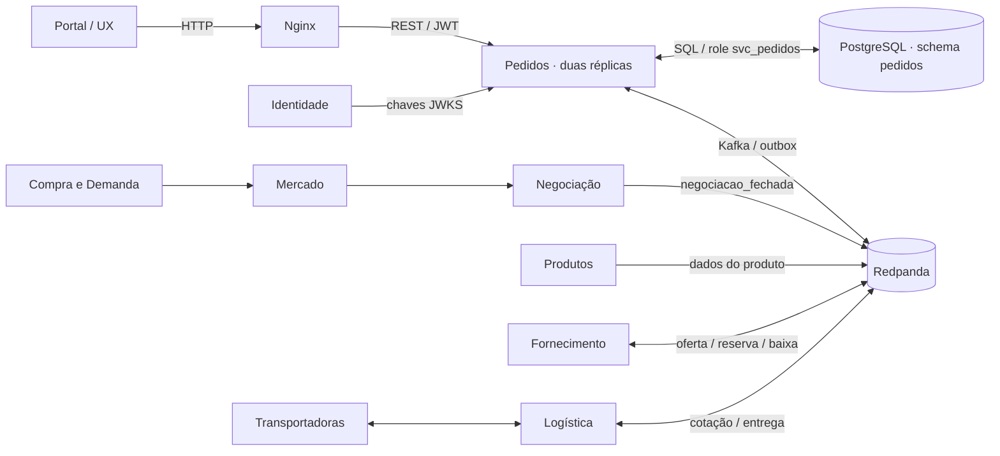

# ESP-PED-001 — Microsserviço de Pedidos do Portal B2B

Perfil de especificação: sistemas-distribuidos 1.0

Serviço: `pedidos-service` · Área de trabalho: `services/pedidos-service/`

| Versão | Data | Situação |
|---|---|---|
| 1.1 | 2026-11-12 | Especificação de trabalho. Consolida os RFs aprovados no VIES e descreve a primeira integração. Os acordos externos em aberto constam na seção 13. |

[Arquitetura](#2-arquitetura) · [Stack](#3-stack-configuração-e-execução) · [Regras e estados](#5-regras-de-negócio-e-estados) · [API HTTP](#6-api-http-autenticação-e-erros) · [Eventos Kafka](#7-contratos-de-integração-por-eventos) · [Aceitação](#8-requisitos-funcionais-e-critérios-de-aceitação) · [Acordos entre grupos](#13-acordos-e-decisões-de-integração)

## 1. Objetivo e escopo

Registrar um pedido comercial por negociação fechada com vencedor. O pedido preserva as condições da compra, permite que as empresas acompanhem sua evolução e coordena, por eventos, as etapas de reserva de estoque, frete, conclusão da venda e entrega.

- **Dentro da v1:** criação por Kafka e pelo `POST` de recuperação, consulta de pedidos e histórico, controle de estados, tratamento da confirmação e recusa de reserva, registro do frete e da entrega, conclusão comercial por status, auditoria, publicação durável e operação no kit da turma.
- **Fora da v1:** emissão de nota fiscal, pagamento, comissão calculada, múltiplos fornecedores ou itens no mesmo pedido, matching, abertura de leilões, lances, escolha da transportadora, rastreio geográfico e manutenção do saldo. O fechamento de Negociação fornece uma oferta vencedora de um único produto. Pedidos registra esse item no próprio pedido.
- **Vocabulário:** reserva reduz o saldo disponível e separa a quantidade para o pedido. Baixa retira definitivamente a quantidade reservada quando a venda é concluída. Liberação devolve ao disponível uma reserva cancelada. Entrega é a confirmação logística da chegada da carga. Outbox é a tabela de eventos que Pedidos grava na mesma transação que a mudança de negócio.

### 1.1 Atores e fronteiras

| Ator ou grupo | Responsabilidade na integração com Pedidos |
|---|---|
| Comprador e fornecedor | Consultam os pedidos vinculados à própria empresa, seus itens, frete e histórico. |
| Operador da plataforma | Recupera a criação por HTTP ou aciona a conclusão comercial na configuração inicial proposta. A identidade do operador fica na auditoria. |
| Mercado / Matching Engine | Recebe oferta e demanda e informa a modalidade a Negociação. Pedidos depende do resultado final de Negociação. |
| Negociação / Leilão | Aplica as regras da modalidade e produz o resultado vencedor ou deserto. Em venda direta, comprador e fornecedor confirmam a proposta antes do fechamento. |
| Compra e Demanda | Fonte proposta da cidade e UF de entrega, da data desejada e da referência à demanda. Negociação leva a condição acordada no fechamento. |
| Produtos | Fonte do nome, unidade, tipo de transporte e peso unitário. Pedidos guarda uma projeção local desses dados. |
| Fornecimento | Fonte da origem, da identidade da oferta e do saldo. Confirma ou recusa a reserva e executa liberação ou baixa. |
| Logística e Transportadoras | Logística abre cotação, informa a seleção, a substituição, a indisponibilidade e a entrega. Transportadoras enviam cotação, alocação e rastreio ao módulo de Logística. |
| Identidade | Emite o JWT, fornece as chaves JWKS e é a autoridade sobre usuários, empresas, escopos e papéis. |
| Infraestrutura | Mantém PostgreSQL, Redpanda, tópicos, gateway, DNS de serviços e observabilidade compartilhada. |
| Banco de Dados | Fornece o modelo DR-BD-002 e valida tipos e migrações. O schema `pedidos` pertence a Pedidos. |
| UX/UI | Integra lista, detalhe, situação e histórico via gateway. Para rastreio e escolha de cotação, usa as interfaces de Logística. |
| Teste e Qualidade | Valida os critérios, envelopes, evidências e o fluxo integrado entre serviços. |

## 2. Arquitetura



- **Domínio:** funções e regras de criação e transição. Recebem fatos já validados, escolhem o efeito e deixam o armazenamento e a publicação para os adaptadores.
- **Aplicação:** os casos de uso HTTP e Kafka convergem para as mesmas transações. Cada instância pode atender HTTP e executar o consumidor e o publicador.
- **Persistência:** PostgreSQL compartilhado fisicamente no kit, com schema e role próprios. Todas as leituras, gravações e FKs ficam no schema `pedidos`. Identificadores de outros serviços são referências lógicas.
- **Integração:** as mutações de negócio entre serviços passam por Kafka. A consulta a JWKS é uma dependência HTTP de autenticação. O portal entra pelo Nginx.
- **Consistência:** Pedidos garante atomicidade no seu banco. Reserva, cotação, entrega e baixa são assíncronas. Cada serviço persiste o próprio efeito e confirma sua etapa com um evento.
- **Instâncias:** réplicas da mesma implantação compartilham banco e grupo Kafka. O estado de negócio, as chaves idempotentes e a fila de publicação sobrevivem à queda de qualquer instância.

## 3. Stack, configuração e execução

| Componente | Escolha para Pedidos |
|---|---|
| Linguagem e HTTP | Python 3.12, FastAPI, Pydantic 2 e Uvicorn. Porta interna `8107`, prefixo `/api/v1/pedidos`. |
| Banco | PostgreSQL 16, banco `portal_b2b`, schema `pedidos`, runtime `svc_pedidos`, migrações com `portal_ddl`. Psycopg 3 com pool de até 5 conexões por processo. Alembic e SQLAlchemy para migrações. |
| Kafka | Redpanda do kit (`v24.1.8` na revisão consultada), cliente `aiokafka` e validação de contratos com `jsonschema`. Broker local na porta `19092`. No Compose, usar `rp-0:9092,rp-1:9092,rp-2:9092`. |
| Autenticação | PyJWT com suporte criptográfico para RS256 e cache de JWKS. |
| Execução e diagnóstico | Docker Compose v2, Nginx (`8080` HTTP e `8443` TLS local), Kafka UI (`8090`), PgAdmin (`5050`), Prometheus e logs JSON. |
| Verificação | pytest, HTTPX, PostgreSQL e Redpanda reais, JSON Schema dos parceiros e k6 para carga. Fixar versões das dependências no primeiro commit executável e registrar a revisão do kit. |

| Configuração | Regra |
|---|---|
| `DATABASE_URL` / `MIGRATION_DATABASE_URL` | DSNs separadas, com as roles de runtime e migração. Só o processo de migração recebe a segunda. |
| `KAFKA_BOOTSTRAP_SERVERS` / `KAFKA_GROUP_ID` | Lista do ambiente e grupo estável `pedidos-service-v1` na integração. Testes isolados usam outro grupo. |
| `JWKS_URL` / `JWT_ISSUER` / `JWT_AUDIENCE` | URL provisionada por Infra e Identidade. Valores esperados `identity-service` e `b2b-platform`. |
| `APP_PORT` / `LOG_LEVEL` | `8107` e `INFO` por padrão. `.env.example` documenta as chaves. Segredos ficam em configuração local ou do ambiente. |

Estrutura do serviço em `services/pedidos-service/`. Esta especificação fica em `docs/pedidos/`.

```text
pedidos-service/
├── app/
│   ├── main.py
│   ├── dominio.py
│   ├── aplicacao.py
│   ├── http.py
│   ├── contratos.py
│   └── adaptadores/
│       ├── postgres.py
│       ├── kafka.py
│       ├── outbox.py
│       └── jwks.py
├── migracoes/
├── contratos/
├── tests/
├── alembic.ini
├── requirements.txt
├── .env.example
├── Dockerfile
└── compose.pedidos.yml
```

Na raiz do kit, preparar o `.env` com `make env` e subir a infraestrutura com `make infra-up`. Sem Make, usar `docker compose up -d pg-primary rp-0 rp-1 rp-2 gateway pgadmin kafka-ui frontends` seguido de `bash ./scripts/init_topics.sh` (Git Bash ou WSL no Windows). Os tópicos adicionais e permissões requerem o provisionamento da seção 13. A aplicação aponta para esse ambiente.

Em `services/pedidos-service/`, com as variáveis exportadas e as dependências instaladas, os pontos de entrada planejados são:

```powershell
python -m pip install -r requirements.txt
python -m alembic upgrade head
python -m uvicorn app.main:app --host 0.0.0.0 --port 8107
```

A integração em contêiner usa o `compose.pedidos.yml` como override das entradas `app1-pedidos` e `app2-pedidos` na rede `portal-net`. O override deve usar `${PEDIDOS_PROJECT_DIR}` como contexto de build para as duas réplicas e para a tarefa `pedidos-migrate`, que recebe a DSN de migração. Na raiz do kit, com banco e brokers saudáveis, tópicos provisionados e DSNs e JWKS configuradas para a rede interna, a sequência prevista é:

```powershell
$env:PEDIDOS_PROJECT_DIR = (Resolve-Path -LiteralPath (Read-Host 'Caminho da pasta pedidos')).Path
$pedidosCompose = Join-Path $env:PEDIDOS_PROJECT_DIR 'compose.pedidos.yml'
docker compose -f docker-compose.yml -f $pedidosCompose config --quiet
docker compose -f docker-compose.yml -f $pedidosCompose run --build --rm pedidos-migrate python -m alembic upgrade head
docker compose -f docker-compose.yml -f $pedidosCompose up -d --build app1-pedidos app2-pedidos gateway
```

Executar a próxima linha só após o sucesso da anterior. O gateway encaminha `http://localhost:8080/api/v1/pedidos` para as réplicas. Se a revisão do kit não ficar saudável, registrar a divergência e usar a revisão corrigida ou o procedimento de integração acordado com Infra. Os comandos de Pedidos dependem dos arquivos previstos nesta seção. [Compose do kit](https://github.com/Printf-PedroCardoso/portal-b2b-kit-infra/blob/630515c4891705fb9563897ec8e2590a9ef7968e/docker-compose.yml)

## 4. Modelo de dados e propriedade

Na v1, `pedido.id` e os IDs gerados por Pedidos são UUID. Os campos externos da tabela abaixo são textos não vazios de até 64 caracteres na integração inicial, com UUID como formato preferencial. Isso aceita os exemplos textuais dos contratos parceiros. Preservar os valores sem converter ou inventar mapeamentos. Comparar `comprador_id` e `fornecedor_id` com o `tenant_id` real emitido por Identidade. Na homologação conjunta, a massa deve usar os mesmos IDs de empresa em todos os serviços.

| Campo ou grupo em `pedidos.pedido` | Tipo e restrição |
|---|---|
| `id`, `negociacao_id` | UUID gerado na criação do pedido e referência externa obrigatória `UNIQUE`, respectivamente. |
| `fornecimento_id`, `produto_id`, `comprador_id`, `fornecedor_id` | Referências externas obrigatórias. O fechamento e a oferta devem concordar em produto e fornecedor. |
| `demanda_id`, `endereco_destino_id`, `reserva_id` | Referências externas opcionais. `reserva_id` passa a ser exigido no fluxo de reserva antecipada quando esse contrato entrar em vigor. |
| `quantidade`, `unidade` | `NUMERIC(12,2)` maior que zero e enum `KG`, `TON`, `UN`, `CX`, `L`. O DR-BD-002 usa inteiro. Decimal é a proposta para preservar quantidades fracionárias dos contratos de Fornecimento e Logística. |
| `valor_unitario`, `valor_total` | `NUMERIC(18,4)` em BRL. Entrada de valor unitário maior que zero com até 2 casas no contrato inicial. Total de mercadoria = quantidade × valor unitário, arredondado para 2 casas com `ROUND_HALF_UP`. Frete tem valor separado. Bloquear valor que não caiba na precisão da coluna. |
| `valor_comissao` | Campo opcional do modelo de referência, sem cálculo na v1. |
| `produto_nome`, `tipo_transporte`, `peso_kg` | Nome entre 1 e 255 caracteres, tipo `GRANEL`, `REFRIGERADO`, `CARGA_SECA` ou `PERIGOSO` e peso positivo `NUMERIC(24,5)`. Snapshot imutável do item na criação. |
| `origem`, `destino`, `data_entrega_desejada` | Origem e destino obrigatórios em `{cidade, uf}`, com cidade de 1 a 120 caracteres e uma das 27 siglas brasileiras em maiúsculas. Data opcional no formato `YYYY-MM-DD`. |
| `status`, `reserva_situacao`, `versao` | Status de negócio da seção 5, situação local da reserva `PENDENTE`, `CONFIRMADA`, `RECUSADA` ou `ENCERRADA` e inteiro monotônico de mudança, iniciado em 1. `ENCERRADA` indica que o fluxo de reserva de um pedido cancelado por falta de frete se encerrou em Pedidos. |
| `criado_em`, `atualizado_em`, `entregue_em` | `TIMESTAMPTZ` em UTC. Os dois primeiros são obrigatórios. O último só é preenchido quando a entrega é aplicada. |

| Registro local | Campos essenciais e finalidade |
|---|---|
| `resultado_negociacao` | `negociacao_id` como chave, resultado `ENCERRADO`/`DESERTO`, `event_id`, dados e hash normalizado dos campos de negócio, `recebido_em` e motivo de pendência. Persiste antes de admitir o `POST`. |
| `produto_referencia`, `fornecimento_referencia` | IDs externos como chave, campos projetados da seção 7, `event_id` e `timestamp` do último estado aplicado. |
| `pedido_frete` | FK local para o pedido, `solicitacao_frete_id`, `entrega_id`, `cotacao_id`, `transportadora_id`, `tentativa` inteira positiva, `preco` em BRL, `prazo_dias`, previsão opcional e situação pendente/aplicada/substituída. Usar `(pedido_id, tentativa)` como chave e preservar a identificação das tentativas substituídas para rejeitar entregas antigas. |
| `fato_logistico_pendente` | Pedido, tipo, ID da solicitação ou par entrega/transportadora, mensagem de origem e horário. Guarda entrega ou indisponibilidade recebida antes de existir correlação segura. Para a mesma chave de negócio, repetir o fato idêntico sem efeito e auditar divergência sem substituir o primeiro fato. |
| `pedido_historico` | `(pedido_id, versao)` único. Estado anterior (nulo na criação), novo estado, origem, motivo, `event_id` ou ator HTTP, `correlation_id` e instante. Troca de transportadora pode manter o status e gerar uma versão nova. |
| `audit_log` | Identidade da ação, pedido ou negociação, usuário, tenant, origem, evento, correlação, instante e resultado. Guarda conflitos sem alterar o pedido. |
| `idempotency_keys` | Chave composta de usuário, contexto, método, caminho efetivo e `Idempotency-Key`. Contexto é o tenant ou o valor reservado `PLATFORM` no acesso global. Hash do corpo normalizado e resposta original, com validade proposta de 24 h. |
| `processed_events` | `(source, event_id)` único, hash da mensagem normalizada, tópico, partição, offset, resultado e instante. Janela mínima proposta de 30 dias. |
| `outbox` | `event_id` UUID único, pedido, versão, tópico, chave, envelope, tentativas, próximo envio, confirmação e erro resumido. Unicidade `(pedido_id, versao)` para os eventos de mudança. |

O peso é igual à quantidade para `KG`, à quantidade × 1000 para `TON` e à quantidade × `pesoUnitarioKg` para `UN`, `CX` e `L`. A fixture usa 1,25 TON a R$ 8,00 por tonelada, com peso esperado de 1.250 kg e valor da mercadoria de R$ 10,00. Quantidade e dinheiro usam `Decimal` na aplicação e saem como números JSON.

## 5. Regras de negócio e estados

| ID | Regra | Requisitos |
|---|---|---|
| RN-PED-01 | Kafka e HTTP usam a mesma criação por `negociacaoId`. Só um fechamento registrado com vencedor pode criar pedido. O banco impõe unicidade, inclusive se duas réplicas processarem a mesma compra. Resultado deserto tem zero pedidos. Um segundo resultado divergente é conflito e preserva o primeiro resultado válido. | PED-01 |
| RN-PED-02 | Consultas aplicam o vínculo da empresa antes da paginação. O histórico é ordenado por versão. Toda consulta de detalhe ou histórico de um pedido fora da visibilidade responde `404`. | PED-02 |
| RN-PED-03 | O contrato inicial reserva a partir de `pedido_criado`. Pedidos confere pedido, oferta, produto, fornecedor e quantidade no evento de confirmação. A recusa válida de uma reserva pendente cancela o pedido e invalida fatos logísticos pendentes. Pedidos emite `CANCELADO` uma vez. | PED-03, PED-05 |
| RN-PED-04 | Frete recebido antes da reserva fica pendente. A confirmação da reserva é a condição para aplicar o frete. A tentativa vigente mais alta substitui a anterior, e dados de uma tentativa obsoleta não avançam a entrega. | PED-04 |
| RN-PED-05 | Pedido, histórico, auditoria, deduplicação e evento de saída são gravados atomicamente quando aplicáveis à mesma mudança. A outbox reutiliza o `eventId` em todo reenvio. Os dois eventos próprios incluem `fornecimentoId`. | PED-01, PED-03, PED-04, PED-05 |
| RN-PED-06 | O pedido é criado com snapshot de compra e de carga completo. Uma projeção ausente, destino faltante ou peso obrigatório ausente deixa a negociação pendente de dados. Com o dado disponível, reavaliar usando a mesma criação idempotente. | PED-01, PED-05 |
| RN-PED-07 | A conclusão comercial produz `VENDA_CONCLUIDA`, que autoriza Fornecimento a baixar a quantidade reservada. Na v1 ela ocorre por status, sem emissão fiscal. O gatilho final e as regras de indisponibilidade constam na seção 13. | PED-04, PED-05 |

### 5.1 Transições e casos fora de ordem

| Estado anterior | Gatilho e precondição | Resultado observável |
|---|---|---|
| Sem pedido | `negociacao_fechada` vencedor com dados completos ou `POST` autorizado após esse registro | `CRIADO`, reserva `PENDENTE`, versão 1 e `pedido_criado`. |
| `CRIADO` | Seleção de frete para o pedido, reserva pendente | Guardar a seleção mais nova. Estado continua `CRIADO`. |
| `CRIADO` | `estoque_atualizado` com `operacao: "RESERVA"`, pedido e oferta correspondentes | `AGUARDANDO_FRETE` e reserva `CONFIRMADA`. Se houver seleção pendente válida, aplicar também `FRETE_SELECIONADO` na mesma transação, com duas versões e duas atualizações em ordem. |
| `CRIADO` | `reserva_estoque_recusada` para a oferta e a quantidade do pedido, reserva pendente | `CANCELADO`, reserva `RECUSADA`, descartar o efeito das seleções e entregas pendentes. |
| `AGUARDANDO_FRETE` | `frete_selecionado` válido, reserva confirmada | `FRETE_SELECIONADO`, seleção vigente gravada. |
| `FRETE_SELECIONADO` ou `VENDA_CONCLUIDA` | `frete_selecionado` com tentativa maior da solicitação vigente, antes da entrega aplicada | Atualizar frete e invalidar a entrega pendente da tentativa anterior. Gravar versão, histórico e evento mantendo o estado. Em seguida, reavaliar eventual entrega da tentativa nova. Tentativa menor é ignorada. Mesma tentativa com dados idênticos é repetição. Mesma tentativa com dados diferentes é conflito. |
| `CRIADO`, `AGUARDANDO_FRETE` ou `FRETE_SELECIONADO` | `frete_indisponivel` terminal da solicitação vigente, conforme acordo proposto | `CANCELADO` com reserva `ENCERRADA`. Se a solicitação ainda não puder ser correlacionada, guardar o fato até identificá-la. Se a causa for `SEM_COTACAO` e já houver seleção válida para a mesma solicitação, tratar como fato conflitante. |
| `FRETE_SELECIONADO` | Configuração inicial proposta: `PATCH` autorizado para `VENDA_CONCLUIDA`, com reserva e frete confirmados | `VENDA_CONCLUIDA` e atualização para baixa. Se a entrega válida já estiver guardada, aplicar em seguida `ENTREGUE`. |
| `VENDA_CONCLUIDA` | `entrega_concluida` da entrega e transportadora vigentes | `ENTREGUE` com o horário recebido de Logística. |
| Pedido em estado não terminal | `entrega_concluida` recebida antes da conclusão comercial ou antes da seleção correspondente, inclusive após `VENDA_CONCLUIDA` | Guardar o fato por `entregaId` e transportadora se a seleção ainda for desconhecida ou se corresponder à seleção vigente e a conclusão comercial estiver pendente. Descartar com diagnóstico se a tentativa for obsoleta ou a transportadora divergir para uma entrega conhecida. Aplicar ao corresponder à seleção vigente e cumprir a regra comercial. |
| `CANCELADO` ou `ENTREGUE` | Evento de negócio tardio ou pedido de mudança | Estado terminal. Duplicatas ficam sem efeito. Registrar diagnóstico se o evento contradisser o estado. Para repetição do comando HTTP, aplicar as regras de idempotência da seção 6.2. |

`solicitacao_frete_criada` registra a solicitação, sem substituir a confirmação de reserva. Uma seleção válida também pode identificar a solicitação quando chega antes desse evento. Mensagens da solicitação divergente ficam sem efeito no estado e são registradas como conflito. Uma segunda decisão conflitante de estoque após a primeira decisão válida é auditada, sem desfazer automaticamente a reserva ou reativar pedido. `LIBERACAO` e `BAIXA` são evidências de estoque, sem transição comercial em Pedidos.

Ao registrar a solicitação por qualquer uma dessas entradas, reavaliar sua indisponibilidade pendente sob o mesmo bloqueio do pedido. Se a entrada atual for uma seleção válida, a regra de conflito de `SEM_COTACAO` considera essa seleção. A indisponibilidade terminal elegível prevalece e gera só o cancelamento, sem publicar uma seleção descartada. Após aplicar uma seleção ou concluir a venda, reavaliar a entrega pendente que corresponda exatamente à tentativa vigente. Ao chegar a um estado terminal, encerrar os fatos pendentes sem novas transições. Uma confirmação de reserva tardia em pedido cancelado não altera a situação pública. A evidência da compensação é `LIBERACAO` se houve reserva, ou o cancelamento preventivo registrado por Fornecimento se ainda não houve.

A regra escolhida para o desenho é reservar provisoriamente antes do resultado quando oferta e quantidade estão firmes. Leilão direto de lote fixo confirma a reserva antes dos lances. Venda direta reserva na abertura da proposta firme com oferta definida. No leilão reverso, apenas a oferta escolhida pede reserva antes do fechamento. Negociação e Fornecimento precisam combinar a expiração, a liberação em deserto e a transferência para o pedido. A criação comercial continua após o fechamento. A primeira integração usa a reserva por `pedido_criado`, que os parceiros já implementaram. [Questão P-29](https://github.com/davicalvarenga/Sistema-MicServ-SD/issues/13)

## 6. API HTTP, autenticação e erros

### 6.1 Acesso

O gateway propaga `X-Correlation-Id`. Pedidos aceita de 1 a 128 caracteres de `[A-Za-z0-9._-]`, inclusive o ID hexadecimal do Nginx. Se ausente ou inválido, gera UUID e devolve o valor efetivo no cabeçalho e nos erros. Um valor recebido de evento é preservado se cumprir o contrato do envelope.

A API de negócio valida JWT Bearer com RS256, `kid`, assinatura, `iss=identity-service`, `aud=b2b-platform`, `exp` e `nbf` quando presente. Usa `sub` para o usuário e `tenant_id` para a empresa. Em uma consulta normal, `BUYER` filtra por comprador, `SUPPLIER` por fornecedor e `TENANT_ADMIN` por qualquer lado da mesma empresa. `CARRIER` não acessa a API de Pedidos. A proposta de operação inicial usa `platform_role=PLATFORM_ADMIN` para os comandos e consultas de suporte, inclusive sem escopo de empresa. Essa capacidade global depende do acordo de autorização da seção 13. Uma chave em cache pode ser usada enquanto estiver válida. No cache miss, consultar a JWKS com timeout de 2 s. Se a consulta responder sem a chave, devolver `401`. Se a consulta falhar e a chave não puder ser obtida, devolver `503`.

### 6.2 Rotas

As rotas de negócio retornam JSON. `POST` e `PATCH` recebem os objetos JSON declarados, com `422` para campos fora do contrato. IDs de pedido na URL são UUID. A listagem e o histórico aceitam `page` a partir de 1 e `size` de 1 a 100, com padrão `page=1&size=10`. A listagem aceita os filtros opcionais `status` e `negociacaoId`, combinados com a visibilidade. A ordenação é `criadoEm DESC, pedidoId DESC` na lista e `versao ASC` no histórico. Uma página sem itens tem `items: []`, preserva `page`, `size` e a contagem `total` do resultado filtrado.

| Método e rota | Entrada | Saída de sucesso |
|---|---|---|
| `POST /api/v1/pedidos` | Objeto com `negociacaoId`. Chave HTTP opcional. | `201` com o detalhe do novo pedido e cabeçalho `Location: /api/v1/pedidos/{pedidoId}`. `200` com o detalhe se a negociação já tiver pedido. |
| `GET /api/v1/pedidos` | Filtros e paginação. | `200` com `{items, page, size, total}`. Cada resumo tem `pedidoId`, `negociacaoId`, `compradorId`, `fornecedorId`, `status`, `valorTotal` e `criadoEm`. |
| `GET /api/v1/pedidos/{id}` | ID na URL. | `200` com o detalhe. |
| `GET /api/v1/pedidos/{id}/historico` | ID e paginação. | `200` com `{items, page, size, total}`. Cada item tem `versao`, `statusAnterior`, `status`, `origem`, `motivo` e `ocorridoEm`. Motivo é nulo quando ausente. A trilha de auditoria detalhada fica interna. |
| `PATCH /api/v1/pedidos/{id}/status` | `{"status":"VENDA_CONCLUIDA"}` e `motivo` opcional de 1 a 240 caracteres. Chave HTTP opcional. | `200` com o detalhe do pedido ao fim da transação, inclusive `status: "ENTREGUE"` se houver entrega vigente já registrada. Configuração inicial proposta de conclusão manual. Após conclusão ou entrega, um novo comando devolve o detalhe atual sem nova mudança. |
| `GET /health` | Sem token, na rede de operação. | `200` com `{"status":"up"}` se o processo estiver vivo. |
| `GET /health/ready` | Sem token, na rede de operação. | `200` com `{"status":"ready"}` quando o schema está migrado e há conectividade com banco e Kafka e tópicos configurados. Senão `503` com `{"status":"not_ready"}`. |
| `GET /metrics`, `GET /docs` | Rede de operação e desenvolvimento. | `200` com exposição Prometheus e Swagger UI, respectivamente. |

Exemplo de `POST` válido:

```json
{"negociacaoId":"31000000-0000-4000-8000-000000000001"}
```

Exemplo de detalhe. `frete` é nulo até a seleção aplicada. Quando preenchido, contém `solicitacaoFreteId`, `entregaId`, `cotacaoId`, `transportadoraId`, `tentativa`, `preco`, `prazoDias` e `dataEntregaPrevista` (nula se ausente). Uma seleção apenas pendente é interna. `reservaSituacao` segue os valores da seção 4.

```json
{
  "pedidoId":"32000000-0000-4000-8000-000000000001",
  "negociacaoId":"31000000-0000-4000-8000-000000000001",
  "compradorId":"30000000-0000-4000-8000-000000000001",
  "fornecedorId":"30000000-0000-4000-8000-000000000002",
  "fornecimentoId":"34000000-0000-4000-8000-000000000001",
  "produtoId":"35000000-0000-4000-8000-000000000001",
  "produtoNome":"Milho em grão",
  "quantidade":1.25,
  "unidade":"TON",
  "valorUnitario":8.00,
  "valorTotal":10.00,
  "pesoKg":1250,
  "tipoTransporte":"GRANEL",
  "origem":{"cidade":"Rio Verde","uf":"GO"},
  "destino":{"cidade":"Anápolis","uf":"GO"},
  "dataEntregaDesejada":null,
  "status":"CRIADO",
  "reservaSituacao":"PENDENTE",
  "frete":null,
  "versao":1,
  "criadoEm":"2026-11-12T14:00:00.000Z",
  "atualizadoEm":"2026-11-12T14:00:00.000Z",
  "entregueEm":null
}
```

Exemplo de item de histórico:

```json
{"versao":2,"statusAnterior":"CRIADO","status":"AGUARDANDO_FRETE","origem":"estoque_atualizado","motivo":null,"ocorridoEm":"2026-11-12T14:01:00.000Z"}
```

`Idempotency-Key`, quando enviada, tem de 1 a 128 caracteres de `[A-Za-z0-9._-]`. O escopo inclui usuário, contexto, método e caminho canônico com o UUID do pedido, quando presente. Para a mesma chave, escopo e corpo, prevalecem o status, o corpo e o `Location` originais durante 24 h. Sem chave ou com chave nova, a resposta reflete o estado da operação atual. O cabeçalho de correlação representa a requisição atual. O mesmo escopo e chave com corpo diferente devolvem `409 IDEMPOTENCIA_CONFLITO`. Serializar a aquisição da chave e gravar a resposta com a mutação na mesma transação. Somente respostas bem-sucedidas consomem a chave. Assim, a tentativa anterior a `negociacao_fechada` pode ser refeita com a mesma chave quando o resultado existir. A unicidade por negociação vale com ou sem esse cabeçalho.

### 6.3 Erros

Padrão inicial `Content-Type: application/problem+json`. `type` é `"about:blank"`. `instance` é o caminho da requisição sem query string. `correlationId` é o cabeçalho efetivo e `timestamp` é UTC em ISO 8601 com milissegundos. Usar os valores abaixo para `title`, `status`, `codigo` e `detail`.

| Situação | `status` | `title` | `codigo` | `detail` |
|---|---:|---|---|---|
| Token ausente ou inválido | 401 | Não autenticado | TOKEN_INVALIDO | Token de acesso ausente ou inválido. |
| Token válido sem empresa ou escopo exigido | 403 | Acesso negado | CONTEXTO_NAO_SELECIONADO | Selecione um contexto de empresa válido. |
| Papel sem acesso à operação | 403 | Acesso negado | ACESSO_NEGADO | Você não tem permissão para esta operação. |
| Pedido ausente ou fora da visibilidade | 404 | Não encontrado | PEDIDO_NAO_ENCONTRADO | Pedido não encontrado. |
| Fechamento ausente ou deserto no `POST` | 409 | Conflito | RESULTADO_INDISPONIVEL | A negociação ainda não tem vencedor registrado em Pedidos. |
| Fechamento válido aguardando dados de carga | 409 | Conflito | DADOS_DO_PEDIDO_PENDENTES | Ainda faltam dados para registrar o pedido. |
| Estado atual impede conclusão | 409 | Conflito | TRANSICAO_INVALIDA | O estado atual do pedido não permite essa transição. |
| Reuso de chave com corpo divergente | 409 | Conflito | IDEMPOTENCIA_CONFLITO | A chave de idempotência já foi usada com outro corpo. |
| Entrada, UUID, enum ou paginação inválidos | 422 | Entrada inválida | VALIDACAO_INVALIDA | Os dados da requisição são inválidos. |
| Banco indisponível ou JWKS necessária indisponível | 503 | Serviço indisponível | DEPENDENCIA_INDISPONIVEL | Uma dependência necessária está indisponível. |
| Falha inesperada | 500 | Erro interno | ERRO_INTERNO | Não foi possível processar a requisição. |

Exemplo com correlação fixa de teste e horário ilustrativo:

```json
{
  "type":"about:blank",
  "title":"Conflito",
  "status":409,
  "codigo":"RESULTADO_INDISPONIVEL",
  "detail":"A negociação ainda não tem vencedor registrado em Pedidos.",
  "instance":"/api/v1/pedidos",
  "correlationId":"teste-ped-01",
  "timestamp":"2026-11-12T14:00:00.000Z"
}
```

A ordem da API é correlacionar, autenticar, autorizar a operação, validar entrada, verificar visibilidade quando aplicável, aplicar idempotência e avaliar o domínio. A rejeição mantém pedido, versão, histórico e outbox. O `401` envia `WWW-Authenticate: Bearer`. O formato `codigo` e os campos extras são o contrato de trabalho de Pedidos até a confirmação com Infra e QA.

## 7. Contratos de integração por eventos

### 7.1 Envelope comum

JSON UTF-8 com os oito campos obrigatórios abaixo. `eventId` é UUID, `eventVersion` é a string `"1.0"`, `timestamp` usa ISO 8601 UTC, `source` identifica o serviço produtor, `correlationId` é texto não vazio de até 128 caracteres e `aggregateId` é o ID de negócio do tópico. A chave Kafka é a mesma string de `aggregateId`. `eventType` é igual ao nome físico do tópico. `payload` é objeto. TLS e ACLs são responsabilidade do ambiente. Cada produtor publica apenas nos tópicos provisionados para sua identidade. Eventos não levam token, segredos ou dados pessoais de motorista.

| Tópico | Produtor → consumidor de interesse | Chave | Situação para Pedidos |
|---|---|---|---|
| `negociacao_fechada` | Negociação → Pedidos | `negociacaoId` | Tópico do kit. Payload vencedor/deserto em alinhamento. |
| `produto_cadastrado`, `produto_atualizado` | Produtos → Pedidos | `produtoId` | Cadastro no kit. Atualização e consumidor de Pedidos precisam de registro. |
| `fornecimento_criado`, `estoque_atualizado` | Fornecimento → Pedidos | `fornecimentoId` | Tópicos no kit. Incluir Pedidos no catálogo e nas permissões. |
| `reserva_estoque_recusada` | Fornecimento → Pedidos | `pedidoId` | Novo tópico proposto. |
| `pedido_criado`, `pedido_atualizado` | Pedidos → Fornecimento e Logística | `pedidoId` | Tópicos do kit. Registrar Fornecimento como consumidor. Transporte só consome atualização se Logística e Infra confirmarem esse vínculo. |
| `solicitacao_frete_criada` | Logística → Pedidos e Transportadoras | `solicitacaoFreteId` | No kit, com chave da solicitação. Pedidos correlaciona pelo `pedidoId` do payload. |
| `frete_selecionado` | Logística → Pedidos | `pedidoId` | Tópico do kit. Payload completo vem da Logística. |
| `entrega_concluida`, `frete_indisponivel` | Logística → Pedidos | `pedidoId` | Novos tópicos propostos. |
| `pedidos.dlt` | Pedidos → operação e QA | Chave original válida ou referência ao offset, conforme seção 9 | DLT do kit. Conferir provisionamento e envelope. |

`source` esperado é `negociacao-service`, `produtos-service`, `fornecimentos-service`, `logistica-service` ou `pedidos-service`, conforme o tópico. Tópicos existentes ficam no catálogo oficial. Para os adicionais, a integração exige atualização no provisionamento, registro no catálogo e ACL. A revisão consultada declara 3 partições, replicação 3, mínimo 2 réplicas em sincronia, retenção de 7 dias e retenção de DLT de 14 dias. Para preservar a compatibilidade `BACKWARD`, mudança de tipo, remoção ou renomeação de campo exige nova versão acordada. [Catálogo de Infra](https://github.com/Printf-PedroCardoso/portal-b2b-kit-infra/blob/630515c4891705fb9563897ec8e2590a9ef7968e/CONTRACTS.md)

### 7.2 Fechamento e dados do pedido

`negociacao_fechada` vencedor, contrato candidato:

```json
{
  "negociacaoId":"31000000-0000-4000-8000-000000000001",
  "status":"ENCERRADO",
  "compradorId":"30000000-0000-4000-8000-000000000001",
  "fornecedorId":"30000000-0000-4000-8000-000000000002",
  "produtoId":"35000000-0000-4000-8000-000000000001",
  "fornecimentoId":"34000000-0000-4000-8000-000000000001",
  "demandaId":"36000000-0000-4000-8000-000000000001",
  "quantidade":1.25,
  "valorUnitario":8.00,
  "destino":{"cidade":"Anápolis","uf":"GO"},
  "dataEntregaDesejada":null
}
```

Identidades dos dois lados, oferta, produto, quantidade e valor unitário acordado são necessários para um fechamento vencedor. `demandaId` é opcional quando o destino acordado vem no próprio fechamento. `dataEntregaDesejada` e `reservaId` são opcionais no primeiro fluxo. Se o destino vier por referência a Demanda, guardar o fechamento pendente até o contrato de leitura por evento estar disponível e o destino ser resolvido. Para deserto, o formato mínimo candidato é `{"negociacaoId":"31000000-0000-4000-8000-000000000002","status":"DESERTO"}`. O boilerplate de Negociação publica `FECHADA`, `vencedorId` e `valorFinal`. Esses campos por si só são insuficientes para criar um pedido. [Boilerplate de Negociação](https://github.com/Printf-PedroCardoso/portal-b2b-kit-infra/blob/630515c4891705fb9563897ec8e2590a9ef7968e/services/negociacao-service/main.py#L164)

| Projeção | Campos consumidos | Regra |
|---|---|---|
| `produto_cadastrado`, `produto_atualizado` | `produtoId`, `nome`, `unidade`, `tipoTransporte` e `pesoUnitarioKg` (opcional ou nulo, positivo com até 3 casas quando presente). | Aplicar snapshot completo do produto com `timestamp` mais recente. Em igualdade com dados divergentes, registrar conflito e preservar o primeiro. |
| `fornecimento_criado` | `fornecimentoId`, `fornecedorId`, `produtoId`, `unidade` e `origem` com cidade e UF. | Validar oferta, produto, fornecedor e unidade. O preço vencedor vem de Negociação. |
| Dados de Demanda | `demandaId`, `destino` e `dataEntregaDesejada` no fechamento, ou em projeção acordada. | A cidade e a UF vêm do destino aprovado para aquela compra. A integração direta com `demanda_criada` depende do contrato desse grupo. |

Para a fixture de carga da seção 8, usar estes recortes dos payloads de produto e de fornecimento. Na integração real, os produtores também preenchem os demais campos de seus próprios schemas.

```json
{"produtoId":"35000000-0000-4000-8000-000000000001","nome":"Milho em grão","unidade":"TON","tipoTransporte":"GRANEL","pesoUnitarioKg":null}
```

```json
{"fornecimentoId":"34000000-0000-4000-8000-000000000001","fornecedorId":"30000000-0000-4000-8000-000000000002","produtoId":"35000000-0000-4000-8000-000000000001","unidade":"TON","origem":{"cidade":"Rio Verde","uf":"GO"}}
```

A carga inicial usa replay dos eventos retidos e, para registros anteriores à retenção, republicação ou exportação versionada pelo dono dos dados. Atualizações em projeções não modificam pedidos existentes. [Contrato de Produtos e Fornecimento v1.2](https://github.com/davicalvarenga/Sistema-MicServ-SD/blob/20537b2b469631e0dc9bf74fdd8ae709bfb0798a/docs/contrato-eventos.md)

### 7.3 Eventos de saída

`pedido_criado` tem o envelope comum completo e o payload abaixo. Os campos são obrigatórios, exceto `dataEntregaDesejada`, que se omite quando ausente. O valor da carga é o total da mercadoria.

```json
{
  "eventId":"37000000-0000-4000-8000-000000000001",
  "eventType":"pedido_criado",
  "eventVersion":"1.0",
  "timestamp":"2026-11-12T14:00:00.000Z",
  "source":"pedidos-service",
  "correlationId":"teste-ped-01",
  "aggregateId":"32000000-0000-4000-8000-000000000001",
  "payload":{
    "pedidoId":"32000000-0000-4000-8000-000000000001",
    "negociacaoId":"31000000-0000-4000-8000-000000000001",
    "compradorId":"30000000-0000-4000-8000-000000000001",
    "fornecedorId":"30000000-0000-4000-8000-000000000002",
    "produtoId":"35000000-0000-4000-8000-000000000001",
    "fornecimentoId":"34000000-0000-4000-8000-000000000001",
    "produtoNome":"Milho em grão",
    "quantidade":1.25,
    "unidade":"TON",
    "pesoKg":1250,
    "tipoTransporte":"GRANEL",
    "valorTotal":10.00,
    "origem":{"cidade":"Rio Verde","uf":"GO"},
    "destino":{"cidade":"Anápolis","uf":"GO"},
    "status":"CRIADO"
  }
}
```

`pedido_atualizado` usa `pedidoId` como chave. Os campos mínimos para Fornecimento e Logística são `pedidoId`, `fornecimentoId` e `status`. Pedidos propõe `versao`, `statusAnterior` e `motivo` opcional como campos aditivos. Validar o payload enriquecido contra os schemas dos dois consumidores no marco de integração.

```json
{
  "pedidoId":"32000000-0000-4000-8000-000000000001",
  "fornecimentoId":"34000000-0000-4000-8000-000000000001",
  "status":"CANCELADO",
  "statusAnterior":"CRIADO",
  "versao":2,
  "motivo":"ESTOQUE_INSUFICIENTE"
}
```

Fornecimento interpreta `CANCELADO` como liberação ou registro de cancelamento preventivo, e `VENDA_CONCLUIDA` como baixa. A baixa é um efeito único por pedido e operação. Uma troca de transportadora após a conclusão pode produzir outra versão com o mesmo status e um novo `eventId`. Antes da homologação, Fornecimento deve confirmar que a deduplicação da baixa usa também `(pedidoId, BAIXA)` ou acordar um marcador obrigatório de primeira conclusão com Pedidos. Logística trata `CANCELADO` como encerramento da cotação ou entrega em andamento. O contrato usa `status` como nome canônico. [Fornecimento](https://github.com/davicalvarenga/Sistema-MicServ-SD/blob/20537b2b469631e0dc9bf74fdd8ae709bfb0798a/docs/contrato-eventos.md) · [Logística](https://github.com/ArrozbR/portal-b2b-logistica-transporte/blob/d72d1ffa2369804b6d779503b9748a33b66361ae/docs/contratos/proposta-grupo-pedidos.md)

### 7.4 Entradas de estoque e logística

Os exemplos abaixo são payloads. Cada entrada usa o envelope comum, com `eventId` próprio e a chave da tabela de tópicos. Campos externos adicionais permitidos pelo schema do produtor podem ser recebidos. Tipos inválidos, referências obrigatórias ausentes, chave divergente e versão de evento desconhecida são erros de contrato. IDs externos e quantidade seguem a seção 4. O `pedidoId` que um parceiro devolve deve ser o UUID gerado por Pedidos.

| Tópico | Campos usados e validação |
|---|---|
| `estoque_atualizado` | IDs de oferta, produto e fornecedor, operação `RESERVA`/`LIBERACAO`/`BAIXA`, `quantidadeMovimentada` positiva, `quantidadeDisponivel` e `quantidadeReservada` não negativas, `pedidoId` UUID ou nulo, `atualizadoEm` em UTC. Só `RESERVA` de um pedido conhecido com os IDs e a quantidade esperada confirma a reserva. |
| `reserva_estoque_recusada` | `pedidoId`, `fornecimentoId`, `quantidadeSolicitada` positiva, `quantidadeDisponivel` não negativa ou nula quando a oferta inexiste, `motivo` e `recusadoEm` em UTC. Motivos `ESTOQUE_INSUFICIENTE` e `FORNECIMENTO_INEXISTENTE`. |
| `solicitacao_frete_criada` | `solicitacaoFreteId`, `pedidoId` e `status: "ABERTA"`. Pedidos pode guardar `prazoDecisaoEm` para diagnóstico. |
| `frete_selecionado` | `pedidoId`, `solicitacaoFreteId`, `entregaId`, `cotacaoId`, `transportadoraId`, `tentativa` inteira a partir de 1, `preco` positivo em BRL com até 2 casas, `prazoDias` inteiro positivo, `dataEntregaPrevista` opcional e `status: "FRETE_SELECIONADO"`. `criterio` quando informado é `ESCOLHA_COMPRADOR` ou `AUTOMATICO_MENOR_PRECO`. |
| `entrega_concluida` | `pedidoId`, `entregaId`, `transportadoraId`, `entregueEm` em UTC. Preservar como contexto `prazoPrometido`, `noPrazo` e `atrasoHoras` quando recebidos (data UTC, booleano e número não negativo). `entregaId` e transportadora precisam corresponder à seleção vigente. |
| `frete_indisponivel` | `pedidoId`, `solicitacaoFreteId`, `motivo` `SEM_COTACAO` ou `SEM_TRANSPORTADORA_DISPONIVEL`, `ocorridoEm` em UTC, `detalhe` textual opcional. O motivo é registrado no cancelamento. |

```json
{
  "fornecimentoId":"34000000-0000-4000-8000-000000000001",
  "produtoId":"35000000-0000-4000-8000-000000000001",
  "fornecedorId":"30000000-0000-4000-8000-000000000002",
  "operacao":"RESERVA",
  "quantidadeMovimentada":1.25,
  "quantidadeDisponivel":98.75,
  "quantidadeReservada":1.25,
  "pedidoId":"32000000-0000-4000-8000-000000000001",
  "atualizadoEm":"2026-11-12T14:01:00.000Z"
}
```

```json
{
  "pedidoId":"32000000-0000-4000-8000-000000000001",
  "fornecimentoId":"34000000-0000-4000-8000-000000000001",
  "quantidadeSolicitada":1.25,
  "quantidadeDisponivel":1.00,
  "motivo":"ESTOQUE_INSUFICIENTE",
  "recusadoEm":"2026-11-12T14:01:00.000Z"
}
```

```json
{"solicitacaoFreteId":"sol-go-21","pedidoId":"32000000-0000-4000-8000-000000000001","status":"ABERTA"}
```

```json
{
  "pedidoId":"32000000-0000-4000-8000-000000000001",
  "solicitacaoFreteId":"sol-go-21",
  "entregaId":"ent-go-31",
  "cotacaoId":"cot-go-18",
  "transportadoraId":"tra-go-8",
  "tentativa":1,
  "preco":150.00,
  "prazoDias":2,
  "dataEntregaPrevista":"2026-11-15",
  "criterio":"ESCOLHA_COMPRADOR",
  "status":"FRETE_SELECIONADO"
}
```

```json
{"pedidoId":"32000000-0000-4000-8000-000000000001","entregaId":"ent-go-31","transportadoraId":"tra-go-8","entregueEm":"2026-11-15T16:00:00.000Z","prazoPrometido":"2026-11-15T21:00:00.000Z","noPrazo":true,"atrasoHoras":0}
```

```json
{"pedidoId":"32000000-0000-4000-8000-000000000001","solicitacaoFreteId":"sol-go-21","motivo":"SEM_COTACAO","detalhe":"Prazo de cotação expirado.","ocorridoEm":"2026-11-13T02:00:00.000Z"}
```

Os payloads de reserva e recusa descrevem cenários independentes. Os demais eventos do mesmo cenário usam a mesma correlação e as identidades do pedido, da solicitação e da tentativa vigente. [Contratos de Fornecimento](https://github.com/davicalvarenga/Sistema-MicServ-SD/blob/20537b2b469631e0dc9bf74fdd8ae709bfb0798a/docs/contrato-eventos.md) · [Eventos publicados por Logística](https://github.com/ArrozbR/portal-b2b-logistica-transporte/blob/d72d1ffa2369804b6d779503b9748a33b66361ae/docs/03-eventos-e-integracoes.md)

## 8. Requisitos funcionais e critérios de aceitação

Os critérios usam os payloads das seções 6 e 7. Em execução, o avaliador troca IDs e correlação por valores próprios de cada cenário. Após a criação, `P` representa o `pedidoId` UUID realmente devolvido e é usado em todos os eventos subsequentes. `N` representa o `negociacaoId` da fixture. Todos os erros HTTP usam o corpo da seção 6.3 com os quatro campos fixos da linha indicada e os campos dinâmicos comparados pelas regras da mesma seção. Para CAs assíncronos, valem o sinal e o prazo da seção 11. Os CAs de uma proposta externa são executados com o contrato candidato local e reexecutados com os serviços parceiros após o aceite.

### PED-01 — Criar um pedido por negociação com vencedor

Consumir `negociacao_fechada` e oferecer `POST /api/v1/pedidos` sobre o mesmo caso de uso. Aplicam-se RN-PED-01, RN-PED-05 e RN-PED-06.

- **CA-PED-01.1.** Dadas as projeções válidas da fixture, quando chegar o fechamento vencedor da seção 7.2, então deve existir uma linha de pedido para `N` em `CRIADO`, com `quantidade=1.25`, `pesoKg=1250`, `valorTotal=10.00`, versão 1 e um evento lógico `pedido_criado` com chave `P` e a mesma oferta.
- **CA-PED-01.2.** Dado `N` sem pedido, quando o mesmo envelope válido chegar cinco vezes e um sexto envelope com outro `eventId` repetir o mesmo resultado, então os seis offsets devem ser confirmados, com uma única linha por `N` e um único `eventId` lógico de criação.
- **CA-PED-01.3.** Dado `N` sem pedido, quando o fechamento com `status: "DESERTO"` for consumido, então o resultado deve ser persistido como deserto, com zero pedidos e zero registros de criação para `N`.
- **CA-PED-01.4.** Dado um pedido `P` já criado por Kafka, quando um operador autorizado fizer `POST /api/v1/pedidos` com `N`, então deve receber `200` com `pedidoId=P`. A contagem de pedidos e de eventos lógicos de criação para `N` deve permanecer 1.
- **CA-PED-01.5.** Dado `N` sem fechamento local vencedor, quando o operador enviar o mesmo `POST`, então deve receber `409 RESULTADO_INDISPONIVEL`, com zero pedidos e zero criações para `N`.
- **CA-PED-01.6.** Dado um fechamento vencedor sem projeção de produto, quando o evento for confirmado, então deve haver resultado pendente e zero `pedido_criado`. O `POST` deve retornar `409 DADOS_DO_PEDIDO_PENDENTES`. Quando os dados de carga chegarem, deve existir exatamente um pedido completo para `N`, mesmo com `POST` concorrente em outra réplica.
- **CA-PED-01.7.** Dado o resultado vencedor pendente, com a última projeção recém-persistida e as reavaliações em segundo plano pausadas no teste, quando um operador fizer o `POST` para `N` com `Idempotency-Key: teste-criar-ped`, então deve receber `201` com o detalhe em `CRIADO`, ID `P` e `Location: /api/v1/pedidos/P` com o UUID real. Repetir com a mesma chave deve recuperar a resposta original. Um comando com outra chave para `N` deve receber `200` com o mesmo pedido. Deve existir uma única criação lógica.

### PED-02 — Consultar pedidos e histórico

Oferecer as três rotas `GET` de negócio da seção 6.2. Aplicam-se RN-PED-02 e as regras de autenticação.

- **CA-PED-02.1.** Dado um token `BUYER` da empresa compradora de `P`, uma transição para `AGUARDANDO_FRETE` e nenhum outro pedido visível, quando listar, abrir detalhe e histórico, então as três respostas devem ser `200`. A lista deve ter `page=1`, `size=10`, `total=1` e o resumo com ID `P`. O detalhe deve indicar `AGUARDANDO_FRETE`. O histórico deve ter `total=2` e versões `[1,2]` na ordem.
- **CA-PED-02.2.** Dado o mesmo token, quando listar com `?page=1&size=101`, então deve retornar `422 VALIDACAO_INVALIDA`, com `application/problem+json`.
- **CA-PED-02.3.** Dado o mesmo pedido e um token `BUYER` de outra empresa sem pedidos, quando listar e consultar diretamente `P` e seu histórico, então a lista deve retornar `200` com `{"items":[],"page":1,"size":10,"total":0}`, e cada consulta direta deve retornar `404 PEDIDO_NAO_ENCONTRADO`.

### PED-03 — Cancelar diante da recusa de estoque

Consumir `reserva_estoque_recusada` e produzir `pedido_atualizado` com o motivo. Aplicam-se RN-PED-03 e RN-PED-05.

- **CA-PED-03.1.** Dado `P` em `CRIADO` com seleção pendente e sem confirmação da reserva, quando chegar a recusa da seção 7.4, então deve ficar `CANCELADO` e `reservaSituacao=RECUSADA`, com `frete=null`. A atualização de cancelamento deve incluir `P`, a mesma oferta e `motivo: "ESTOQUE_INSUFICIENTE"`.
- **CA-PED-03.2.** Dado o cancelamento anterior, quando a recusa for reentregue e depois chegar uma nova seleção para `P`, então deve haver uma única transição e uma única publicação lógica para `CANCELADO`. A seleção tardia deve ter zero efeitos no estado e no frete público.

### PED-04 — Registrar frete, conclusão comercial e entrega

Consumir confirmação de estoque e eventos de Logística. Oferecer o comando HTTP da seção 6.2 segundo a configuração inicial proposta. Aplicam-se RN-PED-04, RN-PED-05 e RN-PED-07.

- **CA-PED-04.1.** Dado `P` em `CRIADO` e reserva pendente, quando chegar a seleção da seção 7.4, então o detalhe deve seguir em `CRIADO`, com `frete=null`. Quando chegar a confirmação de reserva correspondente, o detalhe deve ficar em `FRETE_SELECIONADO`, com `cotacaoId="cot-go-18"` e `tentativa=1`. O histórico e as atualizações devem mostrar as versões 2 e 3, `AGUARDANDO_FRETE` e `FRETE_SELECIONADO`, nessa ordem.
- **CA-PED-04.2.** Dado `P` em `FRETE_SELECIONADO` com reserva confirmada e sem entrega pendente válida, quando o operador autorizado enviar `{"status":"VENDA_CONCLUIDA"}` no `PATCH`, então deve receber `200` com esse status. Deve haver um `pedido_atualizado` com `status: "VENDA_CONCLUIDA"`, sem dependência de nota fiscal. Após o evento de entrega da seleção vigente, o pedido deve estar `ENTREGUE` e conter o `entregueEm` recebido.
- **CA-PED-04.3.** Dado `P` em `FRETE_SELECIONADO`, quando o comprador autenticado e sem papel de operação enviar o mesmo `PATCH`, então deve receber `403 ACESSO_NEGADO`. Pedido, histórico e outbox devem permanecer iguais.
- **CA-PED-04.4.** Dado `P` em `FRETE_SELECIONADO` com seleção de tentativa 1, quando chegar tentativa 2 da mesma solicitação com `entregaId="ent-go-32"`, uma repetição tardia da tentativa 1 e a entrega antiga `"ent-go-31"`, então deve permanecer em `FRETE_SELECIONADO` com tentativa 2. Apenas a troca deve gerar nova versão. A entrega antiga não pode produzir `VENDA_CONCLUIDA` nem `ENTREGUE`.
- **CA-PED-04.5.** Dado `P` em `AGUARDANDO_FRETE` com reserva confirmada, solicitação `"sol-go-21"` registrada e nenhuma seleção, quando chegar `frete_indisponivel` com `SEM_COTACAO` para a solicitação, então deve ficar `CANCELADO` e publicar uma atualização com esse motivo. No teste com Fornecimento, deve ocorrer uma única `LIBERACAO` para `P`. Depende do tópico proposto.
- **CA-PED-04.6.** Dado `P` em `VENDA_CONCLUIDA` com tentativa 1, quando a entrega `"ent-go-32"` da transportadora `"tra-go-9"` chegar antes de uma seleção de tentativa 2 com esses mesmos IDs e a solicitação vigente, então o estado deve ficar `VENDA_CONCLUIDA` até a seleção. Depois, deve ficar `ENTREGUE` na tentativa 2 e o histórico deve registrar a atualização de frete seguida da entrega. No teste integrado, a baixa total deve continuar igual à quantidade de `P`, com uma única movimentação.
- **CA-PED-04.7.** Dado `P` em `FRETE_SELECIONADO` com entrega da tentativa vigente já recebida e guardada, quando o operador autorizado solicitar a conclusão comercial pelo `PATCH`, então deve receber `200` com `status: "ENTREGUE"` e `entregueEm` igual ao valor recebido. O histórico e o broker devem apresentar `VENDA_CONCLUIDA` e `ENTREGUE` em duas versões consecutivas e nessa ordem.

### PED-05 — Persistir histórico, auditoria e publicação

Toda mutação de negócio deve produzir as evidências da seção 4 e seguir a transação da seção 9. Aplicam-se RN-PED-05, RN-PED-06 e RN-PED-07.

- **CA-PED-05.1.** Dado `P` em `CRIADO` na versão 1, quando a recusa de estoque válida causar cancelamento, então a mesma confirmação do banco deve revelar `CANCELADO` versão 2, uma entrada nova no histórico, uma auditoria da ação, o evento de entrada processado e uma outbox da versão 2. A auditoria e a atualização devem preservar a correlação da recusa e a atualização deve conter a oferta original.
- **CA-PED-05.2.** Dado `P` em `CRIADO`, quando o teste induzir erro na inclusão da outbox depois da alteração do pedido e antes do commit, então a transação inteira deve voltar. O pedido deve continuar `CRIADO` na versão anterior, com zero novas entradas de histórico, auditoria ou outbox para aquela mudança. O offset da mensagem deve continuar sem confirmação. Ao remover a falha, a mesma mensagem deve cancelar uma única vez.
- **CA-PED-05.3.** Dado um `pedido_atualizado` já gravado na outbox e ainda sem confirmação persistida do broker, quando o publicador parar e outra réplica assumir após a recuperação, então a atualização deve ser publicada com o `eventId` originalmente armazenado. Se o broker já a tiver recebido, toda cópia deve ter esse mesmo ID. O parceiro deve aplicar a consequência de negócio uma vez.
- **CA-PED-05.4.** Dado um pedido `P` na versão 1, quando chegar um envelope em `frete_selecionado` com chave `P` e sem `payload`, então deve ser publicado em `pedidos.dlt` um evento lógico com chave `P`, `error="EVENTO_INVALIDO"`, `failedAtAttempt=1` e o original preservado conforme a seção 9. Sem o ACK da DLT, o offset deve permanecer pendente. Após o ACK, deve ser confirmado, com `P` ainda na versão 1.

## 9. Consistência, falhas e operação

| Situação | Comportamento de Pedidos |
|---|---|
| Corrida entre Kafka e HTTP ou entre réplicas | Serializar pela linha de resultado da negociação e usar a restrição única de `negociacao_id`. Nas transições, serializar pela linha de pedido e verificar o estado e a versão dentro da transação. |
| Mensagem Kafka válida | Gravar deduplicação e efeitos na mesma transação PostgreSQL. Confirmar o offset só após commit. Processar em ordem dentro de cada partição e nunca confirmar offset que ultrapasse uma mensagem ainda pendente na mesma partição. |
| Mesmo `eventId` e conteúdo | Confirmar a entrega como duplicata, sem nova mutação. Se o ID reaparecer com conteúdo divergente, preservar a primeira aplicação e registrar conflito. Mesmo fechamento com outro ID e mesmos dados normalizados preserva a criação original. |
| Dados de carga pendentes | Guardar o fechamento com a causa e confirmar o offset. Após o commit da projeção, disparar a reavaliação pelo mesmo caso de uso. Um reconciliador de 60 s retoma pendências se o disparo se perder. O `POST` autorizado também reavalia o resultado vencedor persistido e pode completar a criação com as projeções já disponíveis. Proposta de alertar após 24 h, preservando a pendência para correção. Dados de produto ou oferta incompatíveis nunca formam pedido parcial. |
| Ordem entre tópicos | Correlacionar pelos IDs de negócio e aplicar o estado e a tentativa vigentes. Eventos de estoque de outra oferta ou sem pedido correspondente não alteram Pedidos. Evento logístico para pedido desconhecido é registrado como não correlacionado, sem criar pedido. Fornecimento e Logística precisam tratar cancelamento e criação entregues fora de ordem. |
| Erro transitório localizado | Fazer até 3 tentativas de processamento no total, com 1 s e 2 s entre tentativas na proposta inicial. Mensagens válidas que continuam não processáveis após esse limite vão para `pedidos.dlt`. Erro estrutural determinístico segue para DLT na primeira validação. Confirmar a regra com Infra e QA. |
| Banco ou Kafka indisponível | Manter o offset ainda não confirmado e retomar após restabelecer a dependência. Uma indisponibilidade geral não converte em lote mensagens válidas em falha de contrato. Se o banco estiver indisponível, HTTP de negócio retorna `503`. |
| Mensagem inválida e DLT | Publicar em `pedidos.dlt` conforme o envelope de falha descrito abaixo. Confirmar o offset só após o ACK da DLT. Reprocessamento é uma ação operacional após correção, mantendo a identidade original se a mensagem puder ser reaplicada. |
| Falha entre gravação e envio da outbox | Publicar com ACK das réplicas em sincronia, persistir confirmação e retentar o mesmo envelope com atraso exponencial de 1 s até 30 s. Em homologação, usar polling da outbox a cada 1 s e timeout de tentativa de publicação de até 5 s. A outbox mantém a mensagem até confirmação. Alertar se o mais antigo aguarda mais de 60 s em ambiente saudável. |
| Múltiplos publicadores | Selecionar registros vencidos com bloqueio concorrente no banco. Para o mesmo pedido, versão posterior espera a confirmação persistida da anterior, inclusive quando dois status nascem da mesma transação. O consumidor ainda deve tolerar ordem invertida entre tópicos. |
| Cancelamento e compensação | `CANCELADO` termina a etapa de Pedidos. Fornecimento devolve o saldo se houver reserva e Logística encerra a operação vinculada. A confirmação assíncrona da liberação é evidência de homologação. |
| Indisponibilidade após conclusão comercial | Preservar `VENDA_CONCLUIDA` e registrar ocorrência para análise de suporte. Estorno de venda com baixa já aplicada exige fluxo próprio, fora da v1. |

O envelope candidato de DLT mantém os oito campos da seção 7.1. Define `eventType="pedidos.dlt"`, `source="pedidos-service"` e usa como `eventId` um UUIDv5 de namespace URL e nome `pedidos.dlt:topico:particao:offset`. `aggregateId` e a chave Kafka são a chave original se ela for texto UTF-8 de 1 a 128 caracteres. Caso contrário, ambos são `topico:particao:offset`. O `correlationId` usa o valor original válido ou o ID gerado para a DLT. `timestamp` registra o instante UTC da falha. O payload contém `originalEvent`, `error` com o código resumido, `stackTrace` redigido e `failedAtAttempt` inteiro de 1 a 3. Limitar `originalEvent` a 64 KiB após remover segredos. Preservar o objeto se for JSON válido e couber no limite. Para outros formatos, usar texto com substituição de bytes UTF-8 inválidos, truncado no limite em fronteira de caractere. Validar a forma final com Infra.

Logs estruturados devem incluir serviço, nível, instante, `correlationId`, `eventId` e `pedidoId` quando conhecidos. Métricas devem mostrar requisições e latência HTTP, falhas, atrasos do consumidor, contagem de duplicatas e DLT, pendências de dados, quantidade de registros na outbox e idade do mais antigo. IDs, tokens e conteúdo de mensagens não entram como rótulos de métricas. A operação investiga pelo ID de correlação e pelo histórico. Retenção de histórico e auditoria deve seguir a política acordada com Banco e QA.

## 10. Requisitos não funcionais

| ID | Propriedade | Como verificar |
|---|---|---|
| RNF-PED-01 | Isolamento de dados | Com `svc_pedidos`, executar DML no schema próprio, tentar ler e gravar um schema vizinho e inspecionar FKs das migrações. Exigir acesso próprio, rejeição fora do domínio e zero FKs externas. |
| RNF-PED-02 | Desempenho e erros | No kit, via gateway e em duas instâncias, verificar p95 de leitura ≤ 500 ms, p95 de escrita ≤ 1000 ms e respostas 5xx < 1% sob carga saudável. Proposta de ensaio: 1.000 pedidos de 10 tenants, 30 s de aquecimento e 2 min de coleta a 200 usuários simultâneos na leitura. Na rodada de escrita, usar 20 usuários simultâneos e pedidos elegíveis exclusivos para medir o `PATCH` em transições reais. Publicar por rota a amostra, p95, taxa de erro e configuração do ambiente. |
| RNF-PED-03 | Recuperação e unicidade | Repetir CA-PED-01.2 e CA-PED-05.3 com duas réplicas. Contar até 60 s a partir da primeira publicação de verificação aceita pelo broker restabelecido no ambiente de homologação. Exigir um pedido por negociação e um `eventId` lógico por versão. |
| RNF-PED-04 | Segurança entre empresas | Validar token válido, expirado, assinatura inválida, ausência de contexto e acesso cruzado. Os casos de teste devem observar `401`, `403` e `404` conforme seção 6, sem vazamento de dados ou alteração indevida. |
| RNF-PED-05 | Rastreabilidade | Para a mesma compra, recuperar no log, banco e broker a correlação original. Atribuir cada mutação a um usuário ou a um evento, sem incluir JWT ou credenciais. |
| RNF-PED-06 | Prontidão e degradação | Parar banco e broker separadamente, observar `/health` em `200` com o processo vivo e `/health/ready` em `503`. Restabelecer a dependência e exigir `200` de prontidão após migração e conectividade. |

## 11. Homologação e evidências

1. Usar PostgreSQL 16 e Redpanda reais. Usar o gateway para as rotas de negócio. Em testes de Pedidos, fixtures podem representar os produtores externos e uma JWKS de teste pode emitir as chaves conhecidas. Na demonstração integrada, trocar esses produtores pelos serviços parceiros e validar um token de Identidade.
2. Para cada cenário, isolar o banco ou a massa e o grupo observador Kafka. Criar IDs novos de empresas, negociação, oferta e produto, carregar as projeções da seção 7 e usar os IDs reais retornados pelo serviço. Limpar apenas a infraestrutura descartável de testes.
3. Nos CAs assíncronos, o sinal de processamento é o offset confirmado pelo grupo de Pedidos. Verificar o estado persistido, a outbox e os eventos do observador Kafka. Usar polling limitado a 10 s no ambiente saudável, a partir da última publicação de entrada. Em teste com falha deliberada, medir o prazo a partir da recuperação e usar o limite de 60 s de RNF-PED-03. Para duplicatas, confirmar todos os offsets e contar `eventId` distintos, além das linhas de negócio.
4. Em CA-PED-05.2, usar uma falha transitória injetada uma vez no adaptador, depois do `UPDATE` e durante o `INSERT` da outbox. Reter o primeiro retry com uma barreira no teste para observar rollback e offset pendente, liberar a barreira e verificar reprocessamento sem DLT. Testar a exaustão de tentativas em cenário separado. Para CA-PED-05.3, interromper o publicador antes da confirmação persistida e executar a retomada com outra réplica.
5. Rodar `python -m pytest -q --junitxml=resultado-pedidos.xml` em `services/pedidos-service/` após instalar as dependências e configurar a stack. Guardar a versão da ESP, commits dos serviços, comando, massa, saídas HTTP, evidência Kafka, consultas ao banco e resultado de carga.
6. Homologar dois fluxos completos. No fluxo de venda, fechar Negociação, registrar o pedido, confirmar estoque, cotar, selecionar o frete, concluir a venda, observar a baixa e registrar a entrega. No teste da configuração de conclusão manual, trocar a transportadora depois da conclusão e antes da entrega e observar exatamente uma `BAIXA`, mesmo se duas versões tiverem `status=VENDA_CONCLUIDA`. No fluxo de cancelamento, mostrar a recusa de estoque e, em uma segunda execução com reserva efetiva, a indisponibilidade de frete seguida da liberação.
7. A versão lista **23 critérios funcionais**. Contar cada CA uma vez, identificar cenários ainda não executados e medir os RNFs separadamente. Submeter a especificação a QA no G1 e a evidência no G2, conforme o processo da turma. [Processo de Teste e Qualidade](https://github.com/AmandaBfa/AED---Processo-e-Artefato-SD-/blob/efc05b650bf943202c34ccaffc5aa45926bdc624/Entrega_QA_ERS-LLM/01_Processo_Analise_Requisitos.md)

## 12. Ordem de trabalho para Pedidos

1. Fechar o resultado vencedor/deserto com Negociação, validar o `pedido_criado` com os schemas de Fornecimento e Logística e provisionar os tópicos do primeiro fluxo.
2. Implementar a criação, migrações, deduplicação, histórico e outbox. Demonstrar um resultado válido gerando um único pedido e uma publicação que os parceiros reconheçam.
3. Implementar e testar confirmação, recusa, frete antecipado, troca de transportadora, conclusão, entrega e compensação. Acordar a reserva antecipada e o gatilho comercial antes da homologação completa.
4. Integrar a API com Identidade, gateway e UX. Entregar os cenários e evidências para QA. Fazer as mudanças de Pedidos dentro desta pasta e alinhar alterações de contrato com o serviço proprietário.

## 13. Acordos e decisões de integração

Os exemplos das seções anteriores servem de contrato de trabalho local. Cada pendência abaixo indica o que precisa ser confirmado para usar o mesmo contrato com os serviços parceiros.

| ID | Responsáveis | Acordo a fechar e efeito |
|---|---|---|
| INT-PED-01 | Negociação e Pedidos | Fechar `negociacao_fechada` vencedor/deserto, nomes e tipos dos IDs, quantidade e preço unitário. O exemplo candidato usa `ENCERRADO` e `DESERTO`. O marco de criação depende de um exemplo validado por ambos. |
| INT-PED-02 | Compra e Demanda, Negociação, Logística | Compra e Demanda já propõe destino em cidade e UF em ambos os eventos e prazoDesejado opcional. Validar o repasse desses dados de Mercado para Negociação e de Negociação para Pedidos pelo fechamento. Acordar o fuso para converter a data e hora do prazo em dataEntregaDesejada. Com destino faltante, a negociação fica pendente de carga. [Schemas de Demanda](https://github.com/LuccaStuart/portal-b2b-compra-demanda/tree/main/comum/contratos) |
| INT-PED-03 | Produtos, Fornecimento, Logística e Banco | Validar o peso, quantidades fracionárias e precisão monetária. Registrar a divergência com `INT` do DR-BD-002 e testar `1.25 TON` nos dois consumidores. Validar `pedido_criado` enriquecido e `status` canônico com o schema de ambos. |
| INT-PED-04 | Negociação, Fornecimento, Pedidos e professor | Combinar a reserva antecipada da P-29, expiração, liberação em deserto e vínculo sem segunda reserva. Confirmar se a avaliação espera algum registro provisório na abertura. Primeiro marco usa o contrato disponível por `pedido_criado`. |
| INT-PED-05 | Logística, Fornecimento e Pedidos | Confirmar o gatilho de `VENDA_CONCLUIDA` e a baixa única por pedido. Configuração inicial proposta: operador autorizado conclui e a entrega atualiza a etapa logística. Alternativa proposta pelos parceiros: `entrega_concluida` da tentativa vigente aciona `VENDA_CONCLUIDA` e depois `ENTREGUE` na mesma transação, com duas atualizações em ordem. Nessa alternativa, limitar a rota `PATCH` a operações de recuperação formalmente acordadas e revisar CA-PED-04.2. |
| INT-PED-06 | Logística e Pedidos | Confirmar chave `solicitacaoFreteId` de `solicitacao_frete_criada`, registro de solicitação sem transição antes da reserva, `tentativa` crescente e correlação da entrega. Confirmar que `SEM_TRANSPORTADORA_DISPONIVEL` é terminal para a solicitação vigente. Se puder chegar depois de uma seleção de tentativa superior ainda válida, incluir a tentativa no contrato antes de habilitar esse cancelamento. |
| INT-PED-07 | Infra e donos dos tópicos | Provisionar `produto_atualizado`, `reserva_estoque_recusada`, `entrega_concluida`, `frete_indisponivel` e `pedidos.dlt` quando ausentes. Registrar consumidores, versão e ACLs. Conferir rota JWKS, réplicas no gateway, permissões DDL/DML e tempos de retry. |
| INT-PED-08 | Identidade, Infra, QA e UX | Validar `PLATFORM_ADMIN`, escopos e tenancy real, visibilidade de suporte, envelope de erro `codigo` versus `code`, e o formato de lista/detalhe/histórico. `TENANT_ADMIN` permanece limitado à empresa. |
| INT-PED-09 | QA, Banco e Infra | Validar os limites de ensaio, o formato das evidências e a retenção de histórico, auditoria e idempotência. A configuração numérica proposta na seção 10 deve constar na versão homologada. |

## 14. Fontes da especificação

- Materiais da disciplina: diagrama oficial do Portal B2B, Planejamento e viés arquitetural.
- Banco de Dados: DR-BD-002 v1.0, seção 4.10.
- Documentos do projeto: [requisitos VIES de Pedidos](historico/requisitos-vies.md) e [plano de integração pesquisado](historico/plano-de-implementacao.md).
- Infra, revisão `630515c`: [guia do kit](https://github.com/Printf-PedroCardoso/portal-b2b-kit-infra/blob/630515c4891705fb9563897ec8e2590a9ef7968e/README.md), [orientações de arquitetura](https://github.com/Printf-PedroCardoso/portal-b2b-kit-infra/blob/630515c4891705fb9563897ec8e2590a9ef7968e/ORIENTACOES-ARQUITETURA-GRUPOS.md) e [catálogo de eventos](https://github.com/Printf-PedroCardoso/portal-b2b-kit-infra/blob/630515c4891705fb9563897ec8e2590a9ef7968e/CONTRACTS.md).
- Fornecimento e Produtos, revisão `20537b2`: [contrato v1.2 e schemas](https://github.com/davicalvarenga/Sistema-MicServ-SD/blob/20537b2b469631e0dc9bf74fdd8ae709bfb0798a/docs/contrato-eventos.md), [alinhamento com Identidade](https://github.com/davicalvarenga/Sistema-MicServ-SD/issues/2).
- Logística e Transportadoras, revisão `d72d1ff`: [proposta para Pedidos](https://github.com/ArrozbR/portal-b2b-logistica-transporte/blob/d72d1ffa2369804b6d779503b9748a33b66361ae/docs/contratos/proposta-grupo-pedidos.md), [eventos](https://github.com/ArrozbR/portal-b2b-logistica-transporte/blob/d72d1ffa2369804b6d779503b9748a33b66361ae/docs/03-eventos-e-integracoes.md) e [guia de JWT de Identidade](https://github.com/ArrozbR/portal-b2b-logistica-transporte/blob/d72d1ffa2369804b6d779503b9748a33b66361ae/docs/explicacoes/08-token-do-identity-service.md).
- UX e QA: [protótipo do portal](https://portal-b2b-ui-ux.vercel.app) e [modelo de especificação do QA](https://github.com/AmandaBfa/AED---Processo-e-Artefato-SD-/blob/efc05b650bf943202c34ccaffc5aa45926bdc624/Entrega_QA_ERS-LLM/02_Template_Documento_Requisitos.md).
